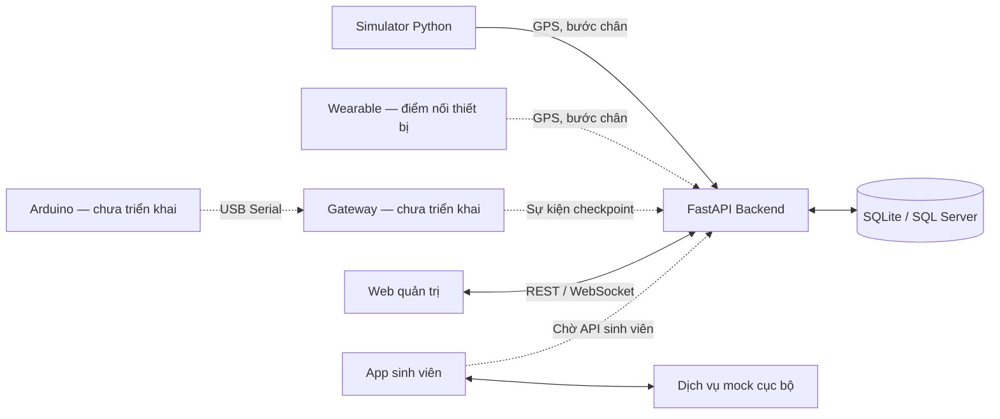

# NEU RUN — Hệ thống ghi nhận sinh viên tham gia giải chạy bộ

NEU RUN là hệ thống quản lý giải chạy dành cho sinh viên Đại học Kinh tế Quốc dân, kết hợp GPS, thiết bị đeo và checkpoint IoT để ghi nhận quá trình tham gia. Ban tổ chức sử dụng web quản trị để quản lý giải, theo dõi người chạy trên bản đồ và tổng hợp kết quả; ứng dụng di động phục vụ các luồng tham gia giải của sinh viên.

> Cập nhật theo mã nguồn trong repository ngày **18/10/2026**. Backend và web quản trị đã có luồng tích hợp REST/WebSocket. App sinh viên hiện hoạt động với dịch vụ mock, đang chờ API sinh viên. Gateway và firmware Arduino mới có khung thư mục.

## Tổng quan hệ thống

| Thành phần | Công nghệ | Trạng thái hiện tại |
| --- | --- | --- |
| Web quản trị | React 19, TypeScript, Vite 7, Leaflet | Kết nối backend qua REST/WebSocket; có chế độ mock độc lập |
| Backend | Python, FastAPI, SQLAlchemy, Pydantic | API quản lý, nhận telemetry, xử lý checkpoint/vòng chạy, phát cập nhật trực tiếp |
| Cơ sở dữ liệu | SQLite mặc định; tùy chọn SQL Server qua pyodbc | SQLite lưu dữ liệu demo bền vững; SQL Server có cấu hình mẫu, chưa được xác minh trong tài liệu kiểm thử hiện có |
| Simulator | Python, nằm trong backend | Tạo giải và phát GPS/bước chân, mô phỏng sự kiện checkpoint qua API |
| App sinh viên | React Native, Expo SDK 57, TypeScript | Có luồng nghiệp vụ mock, GPS thiết bị, lưu hàng đợi cục bộ; adapter API thật đang chờ contract |
| Arduino Gateway | Dự kiến Python/USB Serial | Chưa có mã triển khai; backend đã có API tiếp nhận sự kiện |
| Thiết bị checkpoint | Dự kiến Arduino | Chưa có firmware trong repository |

## Kiến trúc và luồng dữ liệu



Backend là nơi xác nhận số vòng, quãng đường, bước chân và trạng thái hoàn thành trong luồng API của web quản trị. Dữ liệu mock của app sinh viên là dữ liệu riêng, chưa đồng bộ với backend hoặc web quản trị.

Luồng vận hành đã có:

1. Admin tạo giải, hồ sơ sinh viên, đăng ký tham gia và cấu hình tuyến/checkpoint; hoặc khởi động simulator để tạo bộ dữ liệu demo.
2. Wearable hoặc simulator gửi GPS và tổng số bước gắn với sinh viên, thiết bị và phiên chạy.
3. Backend kiểm tra dữ liệu, xử lý checkpoint, cập nhật khoảng cách/vòng chạy và lưu cơ sở dữ liệu.
4. Web quản trị tải dữ liệu qua REST và nhận cập nhật qua WebSocket.
5. Khi đạt số vòng yêu cầu, backend chuyển phiên sang `COMPLETED` và chốt thời gian; giải hoàn thành khi mọi người tham gia đã hoàn tất.

## Chức năng hiện có

### Web quản trị

| Màn hình | Chức năng chính |
| --- | --- |
| Tổng quan | Chọn giải, xem chỉ số, danh sách người chạy, tiến độ và sự kiện mới nhất |
| Bản đồ trực tiếp | Hiển thị tuyến, checkpoint, vị trí GPS mới nhất và danh sách theo dõi |
| Giải chạy | Xem/tạo/xóa giải, xem thông tin giải và quản lý mô phỏng |
| Sinh viên | Tìm kiếm hồ sơ toàn hệ thống, tạo sinh viên, đăng ký vào giải và xem bib |
| Chi tiết phiên chạy | Xem thời gian, quãng đường, bước chân, GPS và sự kiện vòng chạy |
| Trạm kiểm soát | Xem checkpoint, nhật ký ghép GPS/Arduino, đăng ký thiết bị và xác nhận trường hợp mơ hồ |
| Phân tích | Xem tỷ lệ hoàn thành, pace tổng hợp, quãng đường và phân tích theo sinh viên từ dữ liệu hiện có |
| Mô phỏng | Khởi tạo/dừng simulator backend, xem trạng thái và giải được tạo |

Web có editor tuyến/checkpoint và cấu hình ghép GPS/Arduino. Backend chỉ cho sửa tuyến/checkpoint trước khi giải có phiên chạy. Một số chỉ số chưa có dữ liệu tổng hợp, như vòng nhanh nhất toàn giải, được hiển thị là chưa có dữ liệu.

### Backend và checkpoint

- Quản lý giải chạy, sinh viên, đăng ký/bib, wearable, checkpoint và phiên chạy.
- Nhận GPS/bước chân, kiểm tra tọa độ, thời điểm, tốc độ, tính hợp lệ của số bước và chống gửi lặp.
- Tính khoảng cách bằng công thức Haversine, ghi vòng hợp lệ và chốt kết quả phiên.
- Cung cấp dashboard, dữ liệu trực tiếp, chi tiết phiên và nhật ký sự kiện.
- Phân quyền demo bằng các khóa riêng cho Admin, Simulator, Wearable và Gateway.

| Chế độ checkpoint | Cách xử lý |
| --- | --- |
| `GPS_ONLY` | GPS đi vào vùng checkpoint loại `LAP` có thể tạo vòng hợp lệ, theo điều kiện và khoảng thời gian tối thiểu của backend |
| `GPS_AND_ARDUINO` | Ghép lần đi qua checkpoint từ GPS với sự kiện Arduino theo cửa sổ thời gian; nhiều ứng viên chuyển `AMBIGUOUS` để Admin xử lý |

Trong chế độ kết hợp, mặc định runner phải đi từ ngoài bán kính 15 m vào trong 10 m để tạo GPS passage; mất mẫu quá 5 giây sẽ khởi tạo lại trạng thái. Sự kiện Arduino không tự xác định sinh viên. Chi tiết thuật toán và giới hạn nằm trong [tài liệu ghép Arduino/GPS](docs/ARDUINO_GPS_MATCHING.md).

### App sinh viên

- Đăng nhập demo, khám phá giải, đăng ký và nhận bib từ dịch vụ mock.
- Check-in/check-out, bắt đầu, tạm dừng, tiếp tục và kết thúc phiên chạy.
- Xem bản đồ, kết quả, lịch sử, thống kê và hồ sơ cá nhân.
- Tách GPS demo và GPS thiết bị; có mã hỗ trợ GPS nền trên native khi được cấu hình và cấp quyền.
- Lưu snapshot/hàng đợi trong SQLite, lưu thông tin xác thực native bằng SecureStore; hỗ trợ retry và chỉ loại mẫu GPS khi nhận ACK.

**API sinh viên chưa tích hợp:** chế độ `api` hiện trả lỗi `CONTRACT_PENDING`. Backend hiện có API dành cho Admin/Wearable/Gateway, chưa có contract xác thực và thao tác theo quyền sinh viên. Xem [các API còn thiếu](apps/student-mobile/docs/API_GAPS.md).

## Cấu trúc dự án

```text
Smart_Running_Checkpoint_IoT/
├── apps/
│   ├── admin-web/              # Web quản trị React/Vite
│   │   ├── src/                # Giao diện, API adapter, realtime, mock
│   │   └── scripts/            # Kiểm tra UI và tích hợp
│   └── student-mobile/         # App React Native/Expo
│       ├── src/                # Màn hình, GPS, storage, service, state
│       ├── tests/              # Kiểm thử nghiệp vụ
│       └── docs/               # API gaps, Android, bản đồ, báo cáo test
├── services/
│   ├── backend/
│   │   ├── app/main.py         # API, model dữ liệu, nghiệp vụ checkpoint
│   │   ├── app/simulator.py    # Simulator GPS/bước chân/checkpoint
│   │   └── requirements.txt
│   └── arduino-gateway/        # Khung thư mục, chưa triển khai
├── arduino/checkpoint/         # Khung firmware, chưa triển khai
├── docs/                       # Kiến trúc, UML, nghiệp vụ và hướng dẫn
└── README.md
```

## Cài đặt và chạy trên Windows

Các lệnh dưới đây dùng PowerShell. Mỗi phần bắt đầu từ **thư mục gốc repository**, chạy backend và các giao diện ở terminal riêng. Chỉ sao chép `.env.example` khi chưa có `.env` để giữ cấu hình cục bộ.

Yêu cầu: **Python 3.11+**, **Node.js 24 và npm**. Nếu chỉ chạy Admin Web, có thể dùng Node.js 22.12+. Android native cần Android Studio/SDK và JDK phù hợp; iOS native cần macOS/Xcode. SQLite không cần cài dịch vụ database riêng.

### 1. Backend — cổng 8000

```powershell
cd services/backend
python -m venv .venv
.\.venv\Scripts\python.exe -m pip install -r requirements.txt
if (!(Test-Path .env)) { Copy-Item .env.example .env }
```

Sửa `.env`, thay các giá trị mẫu của `ADMIN_API_KEY`, `SIMULATOR_API_KEY`, `WEARABLE_API_KEY` và `GATEWAY_API_KEY` bằng các khóa riêng. Cấu hình local mặc định:

```dotenv
DATABASE_URL=sqlite:///./running_demo.db
CORS_ORIGINS=http://localhost:3000,http://localhost:5173
SIMULATOR_BASE_URL=http://127.0.0.1:8000
```

Chạy server ngay trong thư mục `services/backend` để đọc đúng `.env`:

```powershell
.\.venv\Scripts\python.exe -m uvicorn app.main:app --reload --host 127.0.0.1 --port 8000
```

- Swagger UI: [http://127.0.0.1:8000/docs](http://127.0.0.1:8000/docs).
- Health check: [http://127.0.0.1:8000/health](http://127.0.0.1:8000/health).
- SQLite tự tạo bảng và lưu ở `services/backend/running_demo.db`.

### 2. Web quản trị — cổng 5173

Mở terminal mới từ thư mục gốc:

```powershell
cd apps/admin-web
npm ci
if (!(Test-Path .env)) { Copy-Item .env.example .env }
npm run dev
```

Các giá trị mặc định trong `.env.example`:

```dotenv
VITE_DATA_MODE=api
VITE_API_BASE_URL=http://localhost:8000/api/v1
VITE_WS_BASE_URL=ws://localhost:8000
```

Mở [http://localhost:5173](http://localhost:5173), nhập đúng `ADMIN_API_KEY` đã cấu hình ở backend. Khóa chỉ được giữ trong bộ nhớ frontend; tải lại trang cần nhập lại. Database mới có thể chưa có giải; tạo giải hoặc chạy mô phỏng để có dữ liệu.

Để xem giao diện độc lập, đặt `VITE_DATA_MODE=mock` rồi khởi động lại Vite. Dữ liệu mock frontend không ghi vào backend. Nếu đổi cổng backend, cập nhật cả URL REST, URL WebSocket và `SIMULATOR_BASE_URL`; cập nhật `CORS_ORIGINS` nếu đổi địa chỉ web.

### 3. Chạy mô phỏng qua backend

Trong web quản trị, mở **Mô phỏng**, chọn `GPS_ONLY` hoặc `GPS_AND_ARDUINO` rồi bắt đầu. Simulator mặc định tạo 5 sinh viên có bib `01`–`05`, giải 4 vòng và tuyến khép kín khoảng 425 m/vòng quanh tòa Thế Kỷ với 4 checkpoint.

Cũng có thể mở Swagger UI, dùng **Authorize** với Admin key rồi gọi `POST /api/v1/simulations`:

```json
{
  "checkpoint_mode": "GPS_ONLY",
  "seed": 42,
  "interval_seconds": 0.5
}
```

Theo dõi bằng `GET /api/v1/simulations/{simulation_id}`; dừng bằng `POST /api/v1/simulations/{simulation_id}/stop`. Ở chế độ kết hợp, mặc định giãn thời điểm xuất phát 8 giây; đặt `runner_start_gap_seconds: 0` để thử tình huống nhiều ứng viên gần nhau.

Mô phỏng này gửi dữ liệu vào API và lưu trong database. Các điểm bẻ tuyến là hình học demo, chưa xác minh đường chạy thực địa. Trạng thái job simulator nằm trong bộ nhớ một backend process; sau khi server khởi động lại, dữ liệu đã ghi vẫn còn nhưng job cũ không còn tra cứu được.

### 4. App sinh viên — web preview cổng 8083

Mở terminal mới từ thư mục gốc:

```powershell
cd apps/student-mobile
npm ci
if (!(Test-Path .env)) { Copy-Item .env.example .env }
npm run web
```

Cấu hình demo mặc định:

```dotenv
EXPO_PUBLIC_SERVICE_MODE=mock
EXPO_PUBLIC_GPS_MODE=demo
EXPO_PUBLIC_API_BASE_URL=
EXPO_PUBLIC_BACKGROUND_GPS=false
```

Mở [http://localhost:8083](http://localhost:8083). Hai tài khoản mock là `11223344` và `11223345`, cùng mật khẩu `NeuRun@demo`. Không cần chạy backend cho luồng này.

Để chạy Android native, dùng `npm run android` trong thư mục app; `npm start` khởi động Metro cho development client. Để kiểm tra GPS thiết bị, đặt `EXPO_PUBLIC_GPS_MODE=device` và giữ service ở `mock` cho đến khi có API sinh viên. GPS nền mặc định tắt; thay quyền native hoặc cấu hình Maps cần build lại app. Kiểm tra thêm `.env.local` nếu cấu hình thực tế khác `.env`.

Web preview dùng sơ đồ tuyến để kiểm tra UI. Android dùng Google Maps khi có client key hợp lệ; nếu thiếu key sẽ hiển thị sơ đồ. Xem [hướng dẫn Android](apps/student-mobile/docs/ANDROID_EMULATOR.md), [cấu hình Maps](apps/student-mobile/docs/MAPS_SETUP.md) và [hướng dẫn app](apps/student-mobile/README.md).

## Kiểm tra mã nguồn

Chạy các lệnh sau lần lượt trong `apps/admin-web` và `apps/student-mobile`, sau khi cài dependencies:

```powershell
npm run lint
npm run typecheck
npm test
npm run build
```

`build` của Admin Web tạo bản web production; `build` của app sinh viên xuất bundle Android/iOS/web, **không tạo APK/IPA**. Các kiểm thử UI và tích hợp có yêu cầu môi trường riêng, xem [báo cáo Admin Web](apps/admin-web/INTEGRATION_REPORT.md) và [báo cáo app sinh viên](apps/student-mobile/docs/TEST_REPORT.md).

## Phạm vi và giới hạn

- Hệ thống hiện phục vụ MVP/demo. API key theo vai trò chưa thay thế hệ thống tài khoản và phân quyền người dùng hoàn chỉnh.
- API sinh viên, đồng bộ dữ liệu mobile với backend, gateway Serial và firmware Arduino là các phần còn cần triển khai.
- API nhận telemetry đã có, nhưng khả năng hoạt động với phần cứng thực tế cần được kiểm chứng riêng. Ghép GPS/Arduino theo thời gian không chứng minh danh tính người đứng trước cảm biến.
- SQLite là mặc định cho local/demo. Backend hiện tạo/nâng cấp một số bảng trực tiếp; triển khai lâu dài cần quy trình migration dữ liệu.
- WebSocket và điều phối job/worker hiện dựa vào một backend process; triển khai nhiều worker cần cơ chế chia sẻ trạng thái.
- Kết quả chạy Android Emulator không thay thế kiểm thử GPS, pin, quyền nền và mất mạng trên điện thoại thật. Xem [báo cáo native](apps/student-mobile/docs/NATIVE_FOLLOWUP.md).
- Không commit `.env`, khóa API hoặc database cục bộ. Không đưa khóa Admin/Wearable/Gateway vào app sinh viên hoặc biến `EXPO_PUBLIC_*`.

## Tài liệu liên quan

| Tài liệu | Nội dung |
| --- | --- |
| [Backend](services/backend/README.md) | Cấu hình, API, simulator và lưu trữ |
| [Admin Web](apps/admin-web/README.md) | Cấu trúc frontend và hướng dẫn tích hợp |
| [API coverage của Admin Web](apps/admin-web/API_COVERAGE.md) | Các API đã nối và phần còn thiếu |
| [App sinh viên](apps/student-mobile/README.md) | Cài đặt, mock, GPS và native |
| [API sinh viên còn thiếu](apps/student-mobile/docs/API_GAPS.md) | Contract cần bổ sung để tích hợp backend |
| [Báo cáo backend và chức năng](docs/BAO_CAO_BACKEND_VA_CHUC_NANG_HE_THONG.md) | Nghiệp vụ và phạm vi hệ thống |
| [Ghép Arduino/GPS](docs/ARDUINO_GPS_MATCHING.md) | Quy tắc passage, matching và xử lý sự kiện |
| [Sơ đồ UML](docs/UML_DIAGRAMS.md) · [PlantUML](docs/PLANTUML_DIAGRAMS.puml) | Kiến trúc và mô hình dữ liệu |
| [Hướng dẫn tự học](docs/SELF_STUDY_GUIDE.md) | Tìm hiểu mã nguồn và các thành phần |

Một số README/báo cáo thành phần giữ lại lịch sử thử nghiệm với cổng hoặc commit cũ. Hướng dẫn chạy nhanh ở trên sử dụng cấu hình mẫu hiện tại: backend **8000**, Admin Web **5173**, mobile web preview **8083**.
