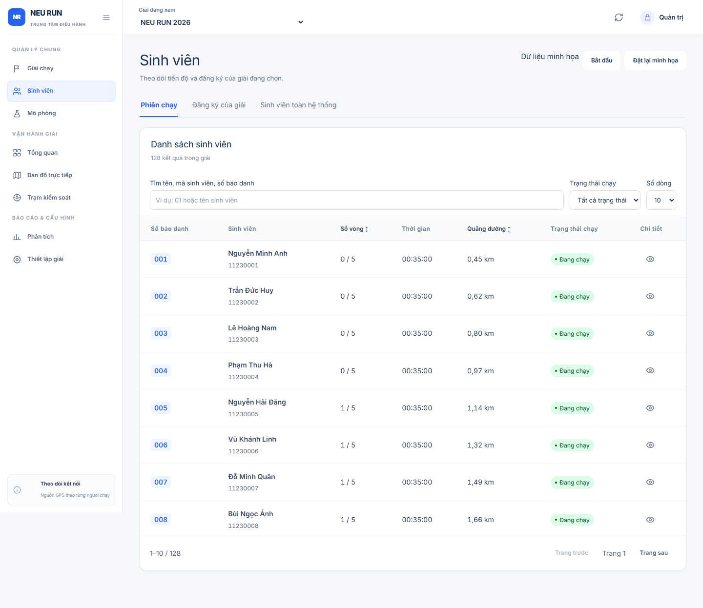
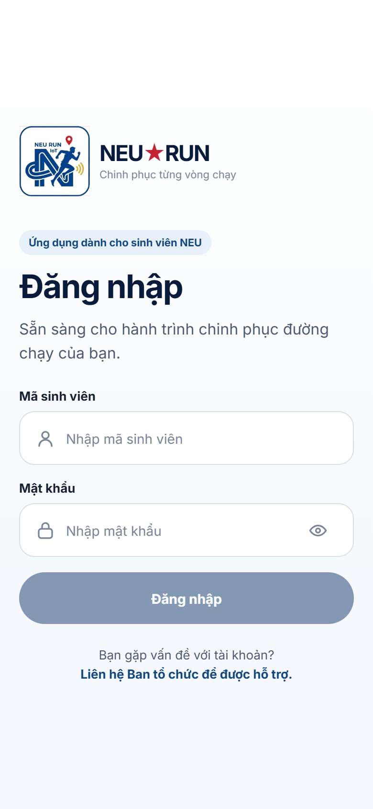
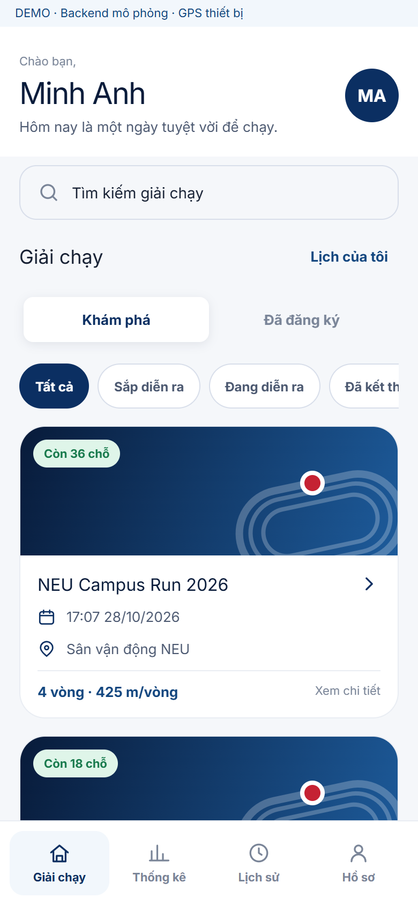
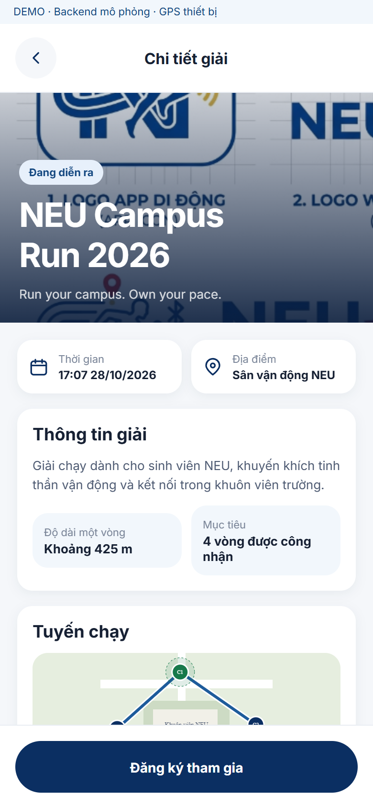
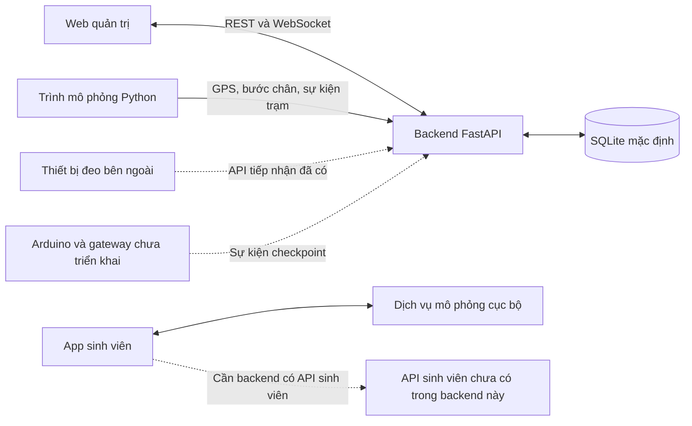

# NEU RUN — Hệ thống ghi nhận sinh viên tham gia giải chạy

NEU RUN hỗ trợ ban tổ chức quản lý giải chạy sinh viên, theo dõi vị trí và ghi nhận kết quả từ GPS, bước chân và sự kiện tại trạm kiểm soát (checkpoint). Repository gồm web quản trị, backend, trình mô phỏng và ứng dụng sinh viên, phục vụ bài toán tổ chức giải chạy tại Đại học Kinh tế Quốc dân.

**Trạng thái đối chiếu ngày 28/10/2026:** backend hiện hỗ trợ luồng quản trị và tiếp nhận dữ liệu thiết bị. App sinh viên chạy được với dữ liệu mô phỏng và đã có bộ kết nối API, nhưng **backend trong repository này chưa có API sinh viên tương ứng**. Chưa có mã gateway hoặc firmware Arduino.

[Giao diện](#giao-dien) · [Chức năng](#chuc-nang) · [Kiến trúc](#kien-truc) · [Cài đặt](#cai-dat) · [API](#api) · [Kiểm thử](#kiem-thu)

## 📌 Tổng quan

Hệ thống tập trung dữ liệu giải chạy, hồ sơ sinh viên, số báo danh (bib), phiên chạy và sự kiện checkpoint để ban tổ chức theo dõi tiến độ, kiểm tra các trường hợp cần xác nhận và xem kết quả. Ứng dụng sinh viên cung cấp giao diện đăng ký, điểm danh, ghi tuyến chạy và tra cứu lịch sử.

| Thành phần | Phạm vi hiện tại |
| --- | --- |
| Web quản trị | Quản lý giải/sinh viên, bản đồ, checkpoint, phân tích và điều khiển mô phỏng qua REST/WebSocket; có chế độ dữ liệu mẫu |
| Backend | Lưu dữ liệu, tiếp nhận GPS/bước chân, ghép GPS với sự kiện checkpoint, ghi vòng và kết quả |
| Trình mô phỏng | Tạo giải, người chạy, thiết bị và gửi dữ liệu vào backend để thử luồng vận hành |
| App sinh viên | Có luồng demo độc lập, GPS thiết bị, hàng đợi cục bộ và bộ kết nối API sinh viên; cần backend tương thích để tích hợp thật |
| Gateway và Arduino | Chưa triển khai trong mã nguồn; backend đã có điểm tiếp nhận sự kiện |

<a id="giao-dien"></a>

## 🖼️ Giao diện

Ảnh chụp từ giao diện chạy cục bộ với **dữ liệu mock**. Các ảnh app sinh viên là bản xem trước trên web, không phải ảnh ứng dụng native hoặc bằng chứng đo GPS thực tế. Dữ liệu mẫu của hai ứng dụng độc lập với nhau.



<table>
  <tr>
    <td width="33%"></td>
    <td width="33%"></td>
    <td width="33%"></td>
  </tr>
  <tr>
    <td align="center">Đăng nhập</td>
    <td align="center">Khám phá giải chạy</td>
    <td align="center">Chi tiết giải</td>
  </tr>
</table>

<a id="chuc-nang"></a>

## ✨ Chức năng

### Quản trị giải chạy

- Tạo, xem và xóa giải; quản lý hồ sơ sinh viên, đăng ký tham gia và số báo danh.
- Xem tổng quan, danh sách người chạy, tiến độ, quãng đường, bước chân và chi tiết phiên.
- Theo dõi GPS trên bản đồ Leaflet; xem tuyến, checkpoint và danh sách người chạy cần chú ý.
- Chỉnh tuyến/checkpoint và cấu hình ghi nhận trước khi giải có phiên chạy; backend khóa các thay đổi này sau khi đã tạo phiên.
- Xem nhật ký checkpoint, đăng ký thiết bị trạm và xác nhận hoặc loại bỏ sự kiện có nhiều ứng viên.
- Xem phân tích hoàn thành, quãng đường và pace từ dữ liệu hiện có; khởi động/dừng mô phỏng backend.

### Xử lý dữ liệu tại backend

- Gắn thiết bị đeo với sinh viên và phiên chạy; nhận GPS cùng tổng số bước trong một yêu cầu.
- Kiểm tra thời điểm, thứ tự mẫu, tọa độ, tốc độ dịch chuyển, số bước và yêu cầu gửi lặp; cộng khoảng cách bằng công thức Haversine.
- Ghi vòng tại checkpoint loại `LAP` khi đạt điều kiện; tự chuyển phiên sang `COMPLETED` khi đủ số vòng. Giải hoàn thành khi phiên mới nhất của mọi người đã đăng ký đều hoàn thành.
- Lưu dữ liệu bằng SQLAlchemy và phát cập nhật WebSocket sau khi ghi nhận.

| Chế độ checkpoint | Cách ghi nhận |
| --- | --- |
| `GPS_ONLY` | Phát hiện chuyển từ ngoài vào trong bán kính checkpoint bằng các mẫu GPS liên tiếp; checkpoint `LAP` có thể ghi vòng nếu đủ thời gian tối thiểu |
| `GPS_AND_ARDUINO` | Ghép lần đi qua checkpoint từ GPS với sự kiện trạm theo cửa sổ thời gian; trường hợp nhiều ứng viên chuyển sang `AMBIGUOUS` để quản trị viên xử lý |

Ở chế độ kết hợp, mặc định dùng bán kính ngoài/trong **15 m / 10 m**, cửa sổ ghép **±3 giây**, thời gian chờ dữ liệu đến muộn **2 giây**; mất mẫu quá **5 giây** sẽ khởi tạo lại trạng thái vùng. Ghép theo thời gian không chứng minh danh tính người đứng trước cảm biến. Xem [quy tắc ghép Arduino/GPS](docs/ARDUINO_GPS_MATCHING.md).

### Ứng dụng sinh viên

- Đăng nhập demo, khám phá giải, đăng ký nhận bib, điểm danh vào/ra.
- Bắt đầu, tạm dừng, tiếp tục phiên; xem tuyến, kết quả, lịch sử, thống kê và hồ sơ.
- Tách GPS mô phỏng và GPS thiết bị; có mã thu GPS nền trên native khi được cấu hình và cấp quyền.
- Lưu dữ liệu/hàng đợi bằng SQLite trên native; gửi lại dữ liệu chờ và chỉ loại mẫu khi nhận xác nhận. Thông tin xác thực native lưu bằng SecureStore.
- Bộ kết nối API đã xử lý đăng nhập, gia hạn token, đổi mật khẩu, đăng ký, điểm danh, phiên chạy và gửi GPS theo lô. Chế độ API không tự chuyển sang mock khi gặp lỗi.

> **Phần tích hợp chưa đồng bộ:** bộ kết nối mobile gọi `/api/v1/student/*`; web có giao diện cấp tài khoản qua `/api/v1/admin/student-accounts` và cấu hình công bố giải qua `/api/v1/admin/races/{race_id}/student-policy`. Các đường dẫn này **chưa được triển khai trong `services/backend/app/main.py` hiện tại**. Tài liệu tích hợp tham chiếu phiên bản backend khác; không thể dùng backend đi kèm để nghiệm thu toàn bộ luồng sinh viên.

<a id="kien-truc"></a>

## 🏗️ Kiến trúc



Backend quyết định kết quả trong luồng quản trị/thiết bị. Dữ liệu mock của web và app sinh viên không đồng bộ với database backend. WebSocket, worker ghép checkpoint và bộ điều phối mô phỏng hiện chạy trong một tiến trình backend.

## 🛠️ Công nghệ

| Nhóm | Công nghệ trong mã nguồn |
| --- | --- |
| Web quản trị | React 19, TypeScript 5.9, Vite 7, React Router, Leaflet/React Leaflet, CSS |
| App sinh viên | React Native 0.86, React 19, Expo SDK 57, TypeScript 6, React Native Web |
| GPS và bản đồ mobile | Expo Location, Task Manager, React Native Maps; sơ đồ tuyến riêng cho web |
| Lưu trữ mobile | Expo SQLite, SecureStore; localStorage/sessionStorage cho dữ liệu/phiên mock trên web |
| Backend | Python, FastAPI, Uvicorn, SQLAlchemy, Pydantic Settings |
| Cơ sở dữ liệu | SQLite mặc định; có tùy chọn kết nối SQL Server qua pyodbc |
| Giao tiếp | REST, WebSocket |
| Kiểm tra | Vitest, ESLint, TypeScript; các script Playwright kiểm tra giao diện/tích hợp |

<a id="cai-dat"></a>

## 🚀 Cài đặt và chạy

Các lệnh dưới đây dùng **PowerShell trên Windows**. Mỗi thành phần chạy ở terminal riêng; bắt đầu từ thư mục gốc repository. Không ghi đè `.env` đã có.

### 1. Chuẩn bị môi trường và lấy mã nguồn

- Git, Node.js và npm; lượt kiểm tra này dùng **Node.js 24.13.0, npm 11.6.2** cho cả hai ứng dụng.
- Python và môi trường ảo; backend được khởi động kiểm tra bằng **Python 3.14.3**. Repository chưa khai báo phiên bản Python bắt buộc bằng `pyproject.toml` hoặc tệp khóa môi trường.
- SQLite không cần cài dịch vụ riêng. Chạy Android native cần Android Studio/SDK và JDK phù hợp; iOS native cần macOS/Xcode.

```powershell
git clone https://github.com/Dunnguyn/Smart_Running_Checkpoint_IoT.git
cd Smart_Running_Checkpoint_IoT
```

### 2. Backend — cổng 8000

```powershell
cd services/backend
python -m venv .venv
.\.venv\Scripts\python.exe -m pip install -r requirements.txt
if (!(Test-Path .env)) { Copy-Item .env.example .env }
```

Sửa `.env`, thay bốn khóa mẫu bằng các giá trị riêng. Ví dụ cấu hình; các giá trị trong dấu `<...>` cần được thay trước khi chạy:

```dotenv
DATABASE_URL=sqlite:///./running_demo.db
ADMIN_API_KEY=<khoa-quan-tri-rieng>
SIMULATOR_API_KEY=<khoa-mo-phong-rieng>
WEARABLE_API_KEY=<khoa-thiet-bi-deo-rieng>
GATEWAY_API_KEY=<khoa-gateway-rieng>
CORS_ORIGINS=http://localhost:3000,http://localhost:5173
SIMULATOR_BASE_URL=http://127.0.0.1:8000
```

Khởi động trong `services/backend` để đọc đúng `.env`:

```powershell
.\.venv\Scripts\python.exe -m uvicorn app.main:app --reload --host 127.0.0.1 --port 8000
```

Kiểm tra [trạng thái backend](http://127.0.0.1:8000/health) và mở [Swagger UI](http://127.0.0.1:8000/docs). Backend tự tạo bảng trong `services/backend/running_demo.db`; database mới chưa có dữ liệu giải chạy.

### 3. Web quản trị — cổng 5173

Tại terminal mới, từ thư mục gốc:

```powershell
cd apps/admin-web
npm ci
if (!(Test-Path .env)) { Copy-Item .env.example .env }
```

Kiểm tra `.env`:

```dotenv
VITE_DATA_MODE=api
VITE_API_BASE_URL=http://localhost:8000/api/v1
VITE_WS_BASE_URL=ws://localhost:8000
```

```powershell
npm run dev
```

Mở [web quản trị](http://localhost:5173), nhập `ADMIN_API_KEY` của backend. Khóa được giữ trong bộ nhớ giao diện; tải lại trang cần nhập lại. Không đưa khóa này vào biến `VITE_*`.

Để xem dữ liệu mẫu độc lập, đổi `VITE_DATA_MODE=mock` rồi khởi động lại Vite. Chế độ mock hiện phù hợp để xem danh sách phiên chạy và một số màn hình; chưa cung cấp đủ dữ liệu cho dashboard/phân tích. Dùng chế độ `api` cùng trình mô phỏng backend để thử luồng quản trị đầy đủ hơn.

### 4. Tạo dữ liệu chạy thử

Trên web quản trị ở chế độ `api`, mở **Mô phỏng**, chọn `GPS_ONLY` hoặc `GPS_AND_ARDUINO` và bắt đầu. Backend mặc định tạo **5 sinh viên**, bib `01`–`05`, giải **4 vòng** và tuyến khoảng **425 m/vòng** với **4 checkpoint** quanh tòa Thế Kỷ.

Cũng có thể mở Swagger, chọn `POST /api/v1/simulations`, bấm **Try it out**, nhập khóa quản trị vào trường header `x-admin-key` và gửi:

```json
{
  "checkpoint_mode": "GPS_ONLY",
  "seed": 42,
  "interval_seconds": 0.5
}
```

Theo dõi bằng `GET /api/v1/simulations/{simulation_id}`; dừng bằng `POST /api/v1/simulations/{simulation_id}/stop`. Chế độ kết hợp mặc định giãn xuất phát 8 giây; đặt `runner_start_gap_seconds: 0` để thử tình huống nhiều người đến gần nhau.

Mô phỏng này **ghi dữ liệu vào database backend**. Tuyến là hình học demo, chưa xác minh thực địa. Khi backend khởi động lại, dữ liệu đã lưu vẫn còn nhưng thông tin job mô phỏng trong bộ nhớ không được khôi phục.

### 5. App sinh viên — bản xem trước web cổng 8083

Tại terminal mới, từ thư mục gốc:

```powershell
cd apps/student-mobile
npm ci
if (!(Test-Path .env)) { Copy-Item .env.example .env }
```

Dùng cấu hình demo để chạy độc lập với backend:

```dotenv
EXPO_PUBLIC_SERVICE_MODE=mock
EXPO_PUBLIC_GPS_MODE=demo
EXPO_PUBLIC_API_BASE_URL=
EXPO_PUBLIC_BACKGROUND_GPS=false
```

```powershell
npm run web
```

Mở [app sinh viên trên web](http://localhost:8083). Tài khoản mẫu được định nghĩa trong dịch vụ mock:

| Mã sinh viên | Mật khẩu chỉ dùng cho mock | Dữ liệu |
| --- | --- | --- |
| `11223344` | `NeuRun@demo` | Có lịch sử minh họa |
| `11223345` | `NeuRun@demo` | Chưa có lịch sử/đăng ký |

Kiểm tra `.env.local` nếu chế độ thực tế khác `.env`; khởi động lại Expo và xóa bộ nhớ đệm khi đổi cấu hình, ví dụ `npx expo start --web --port 8083 --clear`.

**Chạy native:** dùng `npm run android` để tạo/cài development build; `npm start` mở Metro cho development client. Trên macOS dùng `npm run ios`. Đặt `EXPO_PUBLIC_GPS_MODE=device` để thử GPS thiết bị; GPS nền cần bật `EXPO_PUBLIC_BACKGROUND_GPS=true`, build lại và cấp quyền. Android Maps cần `ANDROID_MAPS_API_KEY` phù hợp; nếu thiếu sẽ hiển thị sơ đồ tuyến. Web luôn dùng sơ đồ.

**Chế độ API:** chỉ bật `EXPO_PUBLIC_SERVICE_MODE=api` khi đã có backend cung cấp API sinh viên tương thích, đặt GPS là `device` và khai báo `EXPO_PUBLIC_API_BASE_URL`. Tổ hợp `api` + `demo` bị chặn. Android Emulator có thể truy cập máy phát triển qua `10.0.2.2`; điện thoại thật cần địa chỉ mạng truy cập được và cấu hình backend tương ứng. Không đưa khóa Admin/Wearable/Gateway vào app hoặc biến `EXPO_PUBLIC_*`.

Xem thêm [hướng dẫn Android](apps/student-mobile/docs/ANDROID_EMULATOR.md), [cấu hình bản đồ](apps/student-mobile/docs/MAPS_SETUP.md) và [tích hợp API sinh viên](apps/student-mobile/docs/API_INTEGRATION.md).

### Lưu ý cấu hình

| Tình huống | Cách kiểm tra |
| --- | --- |
| Web không kết nối backend | Kiểm tra `/health`, Admin key, URL REST/WebSocket và `CORS_ORIGINS` |
| Đổi cổng backend | Cập nhật cả `VITE_API_BASE_URL`, `VITE_WS_BASE_URL`, `SIMULATOR_BASE_URL`; khởi động lại các thành phần |
| Đổi địa chỉ/cổng web | Bổ sung đúng địa chỉ web vào `CORS_ORIGINS` |
| API sinh viên hoặc cấp tài khoản báo 404 | Backend đi kèm chưa có các endpoint đó; dùng mobile mock hoặc cung cấp backend tương thích |
| Không tải được nền bản đồ web | Kiểm tra kết nối tới dịch vụ bản đồ OpenStreetMap |

## 🔄 Luồng sử dụng cơ bản

**Ban tổ chức:** khởi động backend → mở web và nhập khóa → tạo dữ liệu bằng mục Mô phỏng → chọn giải → theo dõi Tổng quan/Bản đồ/Sinh viên → kiểm tra nhật ký checkpoint → xem kết quả và phân tích. Nếu tự cấu hình giải, cần hoàn tất tuyến, checkpoint và cấu hình ghi nhận trước khi tạo phiên chạy.

**Sinh viên trong demo:** đăng nhập tài khoản mock → chọn giải → đăng ký → check-in → bắt đầu chạy → tạm dừng/tiếp tục khi cần → xem kết quả, check-out và lịch sử. Dữ liệu của luồng này nằm trong dịch vụ mô phỏng của app, không xuất hiện trên web quản trị.

## 📁 Cấu trúc repository

```text
Smart_Running_Checkpoint_IoT/
├── apps/
│   ├── admin-web/
│   │   ├── src/                 # Màn hình, kết nối API, bản đồ, dữ liệu mẫu
│   │   └── scripts/             # Kiểm tra giao diện và tích hợp
│   └── student-mobile/
│       ├── src/                 # Màn hình, GPS, lưu trữ, dịch vụ, trạng thái
│       ├── tests/               # Kiểm thử nghiệp vụ và bộ kết nối API
│       └── docs/                # Hướng dẫn API, Android, bản đồ, kiểm thử
├── services/backend/
│   ├── app/main.py              # API, model dữ liệu, xử lý nghiệp vụ
│   ├── app/simulator.py         # Trình mô phỏng GPS/bước chân/checkpoint
│   ├── .env.example             # Cấu hình mẫu
│   └── requirements.txt
├── docs/
│   ├── images/                  # Ảnh giao diện dùng trong README
│   └── ...                      # Kiến trúc, UML, ghép checkpoint, tự học
├── output/                      # Báo cáo rà soát đã lưu
└── README.md
```

Các thư mục khung `services/arduino-gateway/` và `arduino/` trong môi trường phát triển hiện chưa có mã được Git theo dõi, nên có thể không xuất hiện sau khi clone. Repository chưa có cấu hình Docker Compose hoặc GitHub Actions được theo dõi.

## 🗄️ Cơ sở dữ liệu

SQLite là lựa chọn mặc định cho local/demo. Model tập trung trong [`main.py`](services/backend/app/main.py), gồm các nhóm: giải và tuyến, sinh viên/đăng ký, thiết bị, phiên/GPS/vòng chạy, sự kiện checkpoint và nhật ký ghép.

- `Base.metadata.create_all()` tạo bảng khi import backend; `migrate_demo_schema()` bổ sung một số cột cho database demo cũ. Chưa có hệ thống migration Alembic hoặc bộ tệp SQL riêng.
- Không có seed tự động khi khởi động. Dùng API quản trị hoặc trình mô phỏng để tạo dữ liệu.
- Có cấu hình SQL Server trong [`.env.example`](services/backend/.env.example): cần tạo database, cài Microsoft ODBC Driver phù hợp và đặt `DATABASE_URL`. Lượt kiểm tra README này chỉ xác minh SQLite.
- Dữ liệu mặc định lưu tại `services/backend/running_demo.db`. Không commit database, `.env` hoặc khóa riêng.

<a id="api"></a>

## 🔌 API

[Swagger UI](http://127.0.0.1:8000/docs) và [OpenAPI JSON](http://127.0.0.1:8000/openapi.json) có sau khi backend chạy ở cổng 8000. Swagger hiện khai báo khóa dưới dạng **header của từng thao tác**; nhập đúng trường `x-admin-key`, `x-simulator-key`, `x-wearable-key` hoặc `x-gateway-key` theo endpoint.

Các đường dẫn REST dưới đây có tiền tố `/api/v1`:

| Phương thức | Endpoint | Chức năng |
| --- | --- | --- |
| `POST` | `/auth/admin-key` | Kiểm tra khóa quản trị |
| `GET`, `POST` | `/races` | Liệt kê, tạo giải |
| `GET`, `POST` | `/students` | Tra cứu, tạo hồ sơ sinh viên |
| `GET`, `POST` | `/races/{race_id}/participants` | Xem danh sách đăng ký, đăng ký sinh viên/bib |
| `GET`, `PUT` | `/races/{race_id}/route` | Đọc, lưu tuyến chạy |
| `GET`, `PATCH` | `/races/{race_id}/checkpoint-matching` | Đọc, sửa cấu hình ghép checkpoint |
| `POST` | `/runner-devices`, `/runs` | Gán thiết bị đeo, tạo phiên chạy |
| `POST` | `/telemetry/gps` | Nhận GPS và tổng số bước bằng khóa Simulator hoặc Wearable |
| `POST` | `/checkpoint-events` | Nhận sự kiện trạm bằng khóa Gateway |
| `POST` | `/checkpoint-events/{event_id}/resolve` | Xử lý sự kiện cần xác nhận |
| `GET` | `/races/{race_id}/dashboard`, `/races/{race_id}/live` | Dữ liệu tổng quan và trực tiếp |
| `POST` | `/simulations` | Khởi động trình mô phỏng |

WebSocket quản trị: `/ws/v1/races/{race_id}/live`, xác thực bằng tham số `key`. Các khóa phân theo vai trò phục vụ demo, chưa phải hệ thống tài khoản và phân quyền người dùng hoàn chỉnh. Bảng trên chỉ liệt kê các API tiêu biểu; xem Swagger để biết schema và toàn bộ thao tác.

<a id="kiem-thu"></a>

## 🧪 Kiểm thử

Chạy lần lượt trong **mỗi** thư mục `apps/admin-web` và `apps/student-mobile`, sau khi cài dependencies:

```powershell
npm run lint
npm run typecheck
npm test
npm run build
```

Kết quả kiểm tra ngày **28/10/2026** trên môi trường nêu ở phần cài đặt:

| Thành phần | Kết quả thực tế |
| --- | --- |
| Web quản trị | Lint, kiểm tra kiểu và **47/47** bài Vitest đạt; bản dựng Vite thành công, còn cảnh báo bundle lớn hơn 500 kB |
| App sinh viên | Lint, kiểm tra kiểu và **47/47** bài Vitest đạt; xuất bundle Android/iOS/web thành công |
| Backend + SQLite tạm | Khởi động Uvicorn, truy cập health/Swagger/OpenAPI, tạo dữ liệu bằng mô phỏng `GPS_ONLY` và gọi dừng mô phỏng thành công |
| Ảnh giao diện | Chụp danh sách phiên chạy quản trị và ba màn hình mobile bằng trình duyệt với dữ liệu mock |

Kiểm tra backend dùng cổng riêng **8019** và database tạm để không tác động dữ liệu đang có; hướng dẫn sử dụng phía trên giữ cổng mặc định **8000**. Kiểm tra mô phỏng chỉ xác minh khởi động/tạo dữ liệu/dừng, chưa chạy đủ một giải.

`build` của web tạo bản production; `build` của mobile xuất bundle, **không tạo APK/IPA**. Kiểm thử API mobile sử dụng phản hồi HTTP giả lập, không chứng minh đã tích hợp với backend thật. Các script Playwright/tích hợp khác có yêu cầu môi trường và dữ liệu riêng; xem [báo cáo web](apps/admin-web/INTEGRATION_REPORT.md) và [báo cáo mobile](apps/student-mobile/docs/TEST_REPORT.md) trước khi chạy.

## Phạm vi cần hoàn thiện

- Đồng bộ phiên bản backend với bộ kết nối API sinh viên và giao diện cấp tài khoản/công bố giải; nghiệm thu đầy đủ luồng đăng ký → điểm danh → chạy → kết quả.
- Bổ sung dữ liệu dashboard cho chế độ mock của web: hiện một số chỉ số trống và màn hình phân tích còn chờ dữ liệu. Chỉ số vòng nhanh nhất toàn giải cũng chưa có dữ liệu tổng hợp trong giao diện.
- Triển khai gateway và firmware Arduino; kiểm thử thiết bị đeo, cảm biến và tuyến chạy thực địa.
- Kiểm chứng GPS nền, mất mạng, pin và quyền vị trí trên điện thoại thật. Việc có hàng đợi không bảo đảm mẫu offline được backend chấp nhận: API GPS hiện giới hạn tuổi mẫu mặc định 10 giây.
- Chuẩn hóa migration và trạng thái dùng chung nếu triển khai nhiều tiến trình backend. SQL Server, thiết bị thật và triển khai production chưa được xác minh trong lượt rà soát này.

## Tài liệu liên quan

| Tài liệu | Nội dung |
| --- | --- |
| [Backend](services/backend/README.md) | Cấu hình, API và trình mô phỏng |
| [Web quản trị](apps/admin-web/README.md) · [Phạm vi API](apps/admin-web/API_COVERAGE.md) | Cấu trúc frontend và tích hợp |
| [App sinh viên](apps/student-mobile/README.md) | Demo, GPS, lưu trữ và chạy native |
| [Tích hợp API sinh viên](apps/student-mobile/docs/API_INTEGRATION.md) | Bộ kết nối đã có và điều kiện phía backend |
| [Ghép Arduino/GPS](docs/ARDUINO_GPS_MATCHING.md) | Quy tắc ghép sự kiện và xử lý trường hợp mơ hồ |
| [Sơ đồ UML](docs/UML_DIAGRAMS.md) · [PlantUML](docs/PLANTUML_DIAGRAMS.puml) | Kiến trúc và mô hình dữ liệu |
| [Báo cáo chức năng](docs/BAO_CAO_BACKEND_VA_CHUC_NANG_HE_THONG.md) · [Tự học](docs/SELF_STUDY_GUIDE.md) | Nghiệp vụ và hướng dẫn đọc mã nguồn |

Một số tài liệu thành phần lưu kết quả theo commit hoặc cấu hình cổng cũ. Khi có khác biệt, đối chiếu mã nguồn và OpenAPI của backend đang chạy; không coi báo cáo lịch sử là kết quả nghiệm thu cho phiên bản hiện tại.
