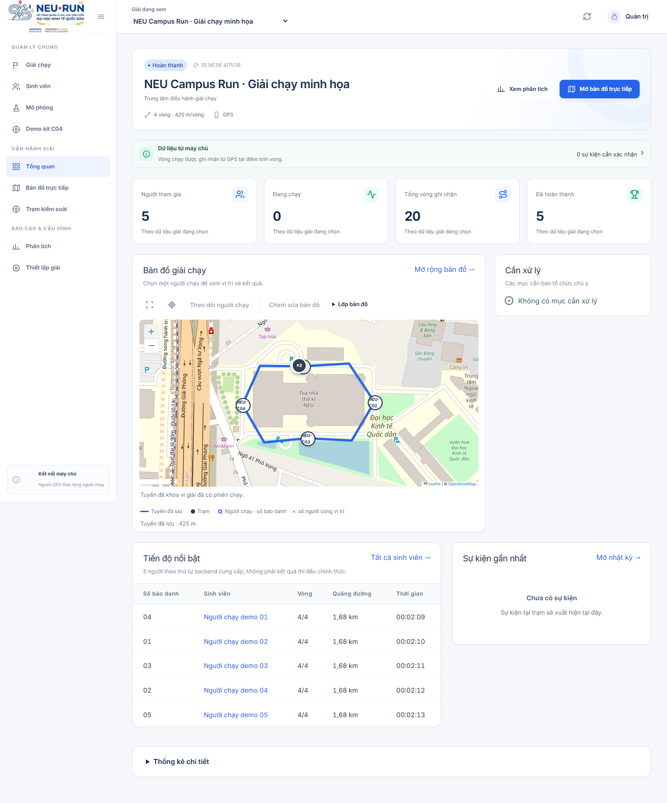
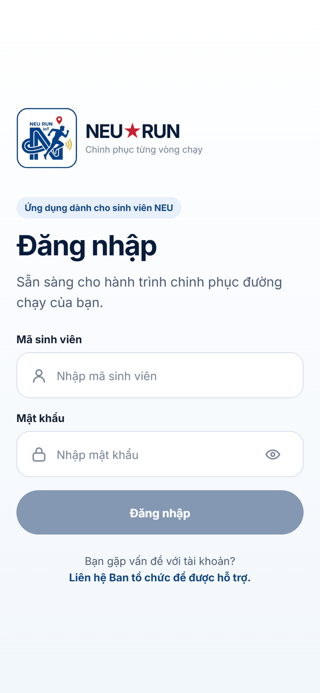
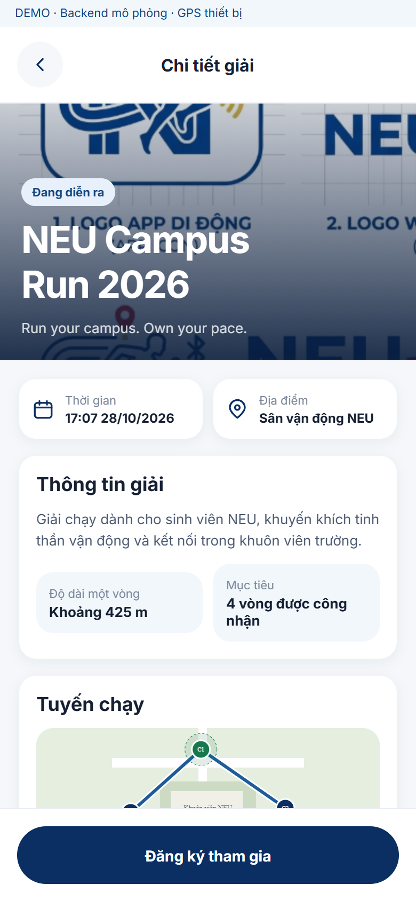

# NEU RUN — Smart Running Checkpoint IoT

NEU RUN là hệ thống hỗ trợ tổ chức và theo dõi giải chạy sinh viên, kết hợp ứng dụng di động, nền tảng quản trị và thiết bị IoT. Hệ thống tập trung dữ liệu đăng ký, phiên chạy, GPS, bước chân và sự kiện tại trạm kiểm soát để quản lý tiến độ và ghi nhận kết quả.

## Giao diện

### Web quản trị

Trang Tổng quan hiển thị tình hình giải chạy, các chỉ số tham gia, bản đồ tuyến chạy và tiến độ của người tham gia.



### Ứng dụng sinh viên

<table>
  <tr>
    <td align="center" width="50%"></td>
    <td align="center" width="50%"></td>
  </tr>
  <tr>
    <td align="center">Đăng nhập</td>
    <td align="center">Chi tiết giải chạy</td>
  </tr>
</table>

Ảnh sử dụng dữ liệu minh họa. Giao diện ứng dụng sinh viên được chụp từ bản xem trước trên web; hình ảnh không đại diện cho kết quả đo GPS hoặc kiểm thử phần cứng thực tế.

## Mục tiêu

- Hỗ trợ ban tổ chức quản lý giải chạy và người tham gia trên một nền tảng thống nhất.
- Cung cấp trải nghiệm đăng ký, điểm danh, theo dõi hoạt động và xem kết quả cho sinh viên.
- Kết hợp dữ liệu vị trí với tín hiệu cảm biến để đối chiếu lượt đi qua trạm kiểm soát.
- Cung cấp các kịch bản mô phỏng và demo phần cứng phục vụ phát triển, kiểm thử và trình diễn.

## Các thành phần

| Thành phần | Vai trò |
| --- | --- |
| Web quản trị | Quản lý giải chạy, sinh viên, tuyến chạy, trạm kiểm soát và kết quả |
| Ứng dụng sinh viên | Đăng ký tham gia, điểm danh, ghi nhận hoạt động và tra cứu lịch sử |
| Backend | Cung cấp API, xử lý nghiệp vụ, lưu trữ dữ liệu và phát cập nhật trực tiếp |
| Bộ mô phỏng | Tạo dữ liệu thử nghiệm cho các kịch bản vận hành |
| Tích hợp IoT | Tiếp nhận tín hiệu thiết bị và hỗ trợ demo với bộ kit Arduino |

## Chức năng chính

### Quản trị giải chạy

- Tạo và quản lý giải chạy, danh sách tham gia và số báo danh.
- Cấu hình tuyến chạy, trạm kiểm soát và điều kiện ghi nhận vòng.
- Theo dõi người chạy, vị trí, quãng đường, bước chân và tiến độ.
- Tra cứu sự kiện tại trạm; xử lý các trường hợp cần xác nhận.
- Xem chi tiết phiên chạy, kết quả và thống kê tổng hợp.

### Trải nghiệm sinh viên

- Xác thực tài khoản và khám phá các giải chạy.
- Đăng ký, điểm danh và quản lý phiên chạy.
- Bắt đầu, tạm dừng, tiếp tục và kết thúc hoạt động.
- Gửi dữ liệu GPS, theo dõi tiến độ và xem lịch sử.
- Tham gia các hoạt động tích lũy quãng đường.

### Xử lý dữ liệu

- Kiểm tra tính hợp lệ của dữ liệu vị trí, thời gian và bước chân.
- Đối chiếu sự kiện GPS với tín hiệu tại trạm kiểm soát.
- Hạn chế ghi nhận trùng và áp dụng điều kiện thời gian tối thiểu giữa các vòng.
- Chốt kết quả theo trạng thái được backend xác nhận.
- Đồng bộ cập nhật qua REST API và WebSocket.

## Kiến trúc tổng quan

Web quản trị và ứng dụng sinh viên giao tiếp với backend để đọc dữ liệu và thực hiện các thao tác nghiệp vụ. Backend tiếp nhận dữ liệu từ ứng dụng, thiết bị hoặc bộ mô phỏng; kiểm tra, lưu trữ và phân phối kết quả tới các giao diện theo dõi.

Backend là nguồn xác nhận trạng thái phiên chạy và số vòng hợp lệ. Giao diện phân biệt dữ liệu mô phỏng với dữ liệu từ thiết bị để thể hiện đúng nguồn thông tin.

## Các chế độ trình diễn

| Chế độ | Đặc điểm |
| --- | --- |
| Mô phỏng giải chạy | Sinh dữ liệu người chạy, GPS, bước chân và sự kiện trạm để thử nghiệm luồng vận hành |
| Demo bộ kit C04 | Cảm biến ghi nhận lượt qua thực tế; GPS và bước chân được mô phỏng |
| Mô phỏng hoạt động tích lũy | Minh họa tiến độ và kết quả tích lũy quãng đường theo nhiều ngày |
| Dữ liệu mẫu trên giao diện | Hỗ trợ xem trước trải nghiệm mà không yêu cầu kết nối thiết bị |

### Demo bộ kit C04

Demo kit sử dụng một trạm xuất phát và về đích, với mục tiêu hoàn thành hai vòng:

1. Lượt qua đầu tiên mở phiên và bắt đầu ghi nhận thời gian.
2. Lượt qua hợp lệ tiếp theo xác nhận hoàn thành vòng thứ nhất.
3. Lượt qua hợp lệ cuối cùng xác nhận vòng thứ hai và chốt kết quả.

Mỗi vòng yêu cầu tối thiểu 60 giây. Tuyến GPS mô phỏng dài khoảng 400–450 m mỗi vòng, với tốc độ khoảng 3,2 m/s. Demo kit có luồng điều khiển riêng với các kịch bản mô phỏng giải chạy.

## Công nghệ

| Lớp hệ thống | Công nghệ |
| --- | --- |
| Web quản trị | React, TypeScript, Vite, React Router, Leaflet |
| Ứng dụng sinh viên | React Native, Expo, TypeScript |
| Vị trí và lưu trữ di động | Expo Location, Task Manager, SQLite, SecureStore |
| Backend | Python, FastAPI, SQLAlchemy, Pydantic |
| Cơ sở dữ liệu | SQLite mặc định; có cấu hình kết nối SQL Server |
| Giao tiếp | REST API, WebSocket, Serial |
| Kiểm tra chất lượng | TypeScript, ESLint, Vitest, Playwright |

## Môi trường phát triển

| Công cụ | Mục đích | Môi trường tham chiếu |
| --- | --- | --- |
| Git | Quản lý mã nguồn | Git CLI |
| Node.js và npm | Cài đặt, chạy và dựng các ứng dụng frontend | Node.js 24.13, npm 11.6 |
| Python | Chạy backend và bộ mô phỏng | Python 3.14 |
| SQLite | Lưu dữ liệu phát triển và demo | Không cần cài dịch vụ riêng |
| Microsoft Edge | Chạy các script kiểm thử giao diện hiện có | Cần khi kiểm thử bằng Playwright |

Các phiên bản trên là môi trường tham chiếu, không phải cam kết tương thích với mọi phiên bản khác. Dùng các tệp khóa phụ thuộc có sẵn để cài đặt frontend nhất quán.

Để chạy Android native, cần Android Studio, Android SDK, JDK phù hợp và máy ảo hoặc thiết bị đã bật chế độ phát triển. Chạy iOS native cần macOS và Xcode. Demo phần cứng cần Arduino, cảm biến HC-SR04, cáp USB truyền dữ liệu và chương trình trên kit tương thích với tín hiệu START/LAP.

SQL Server là tùy chọn; nếu sử dụng cần chuẩn bị cơ sở dữ liệu và ODBC Driver phù hợp. Các bước dưới đây dùng SQLite.

## Cài đặt và chạy

Các lệnh bên dưới sử dụng **PowerShell trên Windows**, bắt đầu từ thư mục gốc của bản sao repository. Mỗi thành phần chạy trong một terminal riêng. Các đường dẫn đều tương đối trong repository; địa chỉ kết nối chỉ là ví dụ trên máy phát triển.

### 1. Backend

```powershell
cd services/backend
python -m venv .venv
.\.venv\Scripts\python.exe -m pip install -r requirements.txt
if (!(Test-Path .env)) { Copy-Item .env.example .env }
```

Trước khi khởi động, chỉnh cấu hình trong tệp môi trường vừa tạo:

| Biến môi trường | Cách cấu hình |
| --- | --- |
| `DATABASE_URL` | Giữ cấu hình SQLite trong mẫu để chạy thử |
| `ADMIN_API_KEY` | Khóa riêng cho quản trị viên |
| `SIMULATOR_API_KEY` | Khóa riêng cho bộ mô phỏng |
| `WEARABLE_API_KEY` | Khóa riêng cho thiết bị đeo |
| `GATEWAY_API_KEY` | Khóa riêng cho gateway |
| `STUDENT_JWT_SECRET` | Bí mật ký token của ứng dụng sinh viên |
| `CORS_ORIGINS` | Danh sách nguồn web được phép, khớp với địa chỉ frontend |
| `SIMULATOR_BASE_URL` | Địa chỉ backend mà bộ mô phỏng có thể truy cập |

Thay toàn bộ giá trị khóa mẫu bằng các giá trị ngẫu nhiên riêng biệt. Có thể chạy lệnh sau cho từng khóa rồi lưu kết quả vào cấu hình cục bộ:

```powershell
python -c "import secrets; print(secrets.token_urlsafe(48))"
```

Khởi động backend trong cùng terminal:

```powershell
.\.venv\Scripts\python.exe -m uvicorn app.main:app --reload --host 127.0.0.1 --port 8000
```

Backend cung cấp kiểm tra trạng thái tại `http://127.0.0.1:8000/health` và tài liệu API tại `http://127.0.0.1:8000/docs`. Cơ sở dữ liệu SQLite được tạo khi ứng dụng khởi tạo; dữ liệu mới có thể được tạo bằng giao diện quản trị hoặc bộ mô phỏng.

### 2. Web quản trị

Trong terminal mới, bắt đầu từ thư mục gốc repository:

```powershell
cd apps/admin-web
npm ci
if (!(Test-Path .env)) { Copy-Item .env.example .env }
```

Thiết lập cấu hình kết nối:

```dotenv
VITE_DATA_MODE=api
VITE_API_BASE_URL=http://localhost:8000/api/v1
VITE_WS_BASE_URL=ws://localhost:8000
```

```powershell
npm run dev
```

Mở địa chỉ do Vite hiển thị, mặc định là `http://localhost:5173`, rồi nhập khóa quản trị đã thiết lập ở backend. Khóa chỉ được giữ trong bộ nhớ giao diện; không đưa khóa vào biến `VITE_*`.

- **Tổng quan:** theo dõi giải đang chọn, bản đồ và tiến độ người chạy.
- **Mô phỏng:** tạo dữ liệu chạy thử qua backend mà không cần kit thật.
- **Demo kit C04:** chọn cổng COM, xác nhận thông tin người tham gia và kết nối bộ kit. Đóng Arduino Serial Monitor trước khi kết nối; nhấn START trên kit và thực hiện ba lượt qua theo hướng dẫn.

Để xem trước giao diện độc lập, có thể đặt `VITE_DATA_MODE=mock` và khởi động lại Vite. Chế độ này không kết nối bộ kit thật.

### 3. Ứng dụng sinh viên

Trong terminal mới, bắt đầu từ thư mục gốc repository:

```powershell
cd apps/student-mobile
npm ci
if (!(Test-Path .env)) { Copy-Item .env.example .env }
```

Cấu hình xem trước bằng dữ liệu mẫu:

```dotenv
EXPO_PUBLIC_SERVICE_MODE=mock
EXPO_PUBLIC_GPS_MODE=demo
EXPO_PUBLIC_API_BASE_URL=
EXPO_PUBLIC_BACKGROUND_GPS=false
```

```powershell
npm run web
```

Bản xem trước mặc định chạy tại `http://localhost:8083`. Để kết nối backend, chuyển chế độ dịch vụ sang `api`, GPS sang `device` và đặt `EXPO_PUBLIC_API_BASE_URL` tới backend mà thiết bị có thể truy cập. Tài khoản sinh viên phải được cấp qua luồng quản trị; không sử dụng tài khoản mẫu để xác minh tích hợp thật.

Nếu dùng bản web ở chế độ API, bổ sung nguồn web tương ứng vào `CORS_ORIGINS` của backend. Bản đồ native trên Android có thể cần `ANDROID_MAPS_API_KEY` được giới hạn theo ứng dụng và chứng thư ký; không dùng khóa dịch vụ phía máy chủ.

Với Android, chạy `npm run android` sau khi chuẩn bị SDK và thiết bị. Trên macOS, dùng `npm run ios`. Lệnh `npm start` mở máy chủ phát triển cho development client. GPS nền yêu cầu bật cấu hình tương ứng, tạo lại bản dựng native và cấp quyền trên thiết bị. Chế độ API không chấp nhận GPS mô phỏng.

Địa chỉ `localhost` trên điện thoại trỏ tới chính điện thoại. Khi thử trên thiết bị thật, cần cấu hình backend lắng nghe trên giao diện mạng phù hợp và cung cấp địa chỉ thiết bị có thể truy cập. Chỉ mở kết nối trong môi trường phát triển được kiểm soát.

### Kiểm tra cấu hình

| Tình huống | Nội dung cần kiểm tra |
| --- | --- |
| Web không kết nối backend | Backend đã chạy, địa chỉ REST có tiền tố API, khóa quản trị và CORS |
| Đổi cổng backend | Cập nhật kết nối REST, WebSocket, bộ mô phỏng và ứng dụng sinh viên |
| Thay đổi biến môi trường chưa có hiệu lực | Khởi động lại thành phần tương ứng; kiểm tra cấu hình môi trường cục bộ ghi đè |
| Không tìm thấy cổng COM | Cáp USB, driver thiết bị, cổng được hệ điều hành nhận và tiến trình khác đang giữ cổng |
| Không ghi được GPS | Quyền vị trí, chế độ GPS, cấu hình bản dựng và kết nối tới backend |

Không commit tệp cấu hình riêng, khóa truy cập hoặc cơ sở dữ liệu phát sinh khi chạy thử.

## Kiểm thử và phạm vi sử dụng

Dự án có kiểm tra kiểu dữ liệu, quy tắc mã nguồn, kiểm thử tự động và các kịch bản kiểm thử giao diện. Kiểm thử bằng dữ liệu giả lập phục vụ xác minh hành vi phần mềm; kiểm thử thiết bị thật cần được thực hiện riêng.

Sau khi cài đặt phụ thuộc, chạy các lệnh sau trong thư mục của từng ứng dụng frontend:

```powershell
npm run typecheck
npm run lint
npm test
npm run build
```

Bản dựng web quản trị tạo tài nguyên phục vụ triển khai. Lệnh build của ứng dụng sinh viên xuất bundle; không tạo gói cài đặt APK hoặc IPA. Các script kiểm thử giao diện có thể có yêu cầu dữ liệu riêng, cần kiểm tra trước khi chạy trên môi trường dùng chung.

Phiên bản hiện tại phục vụ phát triển, nghiên cứu và trình diễn. Việc triển khai vận hành cần đánh giá thêm về bảo mật, phân quyền, bảo vệ dữ liệu vị trí, độ ổn định GPS, sao lưu và khả năng mở rộng.

## Nguyên tắc dữ liệu

- Chỉ sử dụng dữ liệu tổng hợp hoặc đã được ẩn danh trong nội dung công khai.
- Không đưa thông tin cá nhân, tài khoản, mật khẩu, khóa truy cập hoặc dữ liệu vị trí cá nhân vào tài liệu và dữ liệu thử nghiệm được công bố.
- Không đưa cấu hình riêng, dữ liệu vận hành hoặc nhật ký chứa thông tin nhạy cảm vào kho mã nguồn.
- Phân biệt rõ dữ liệu minh họa, dữ liệu mô phỏng và kết quả đo thực tế.
