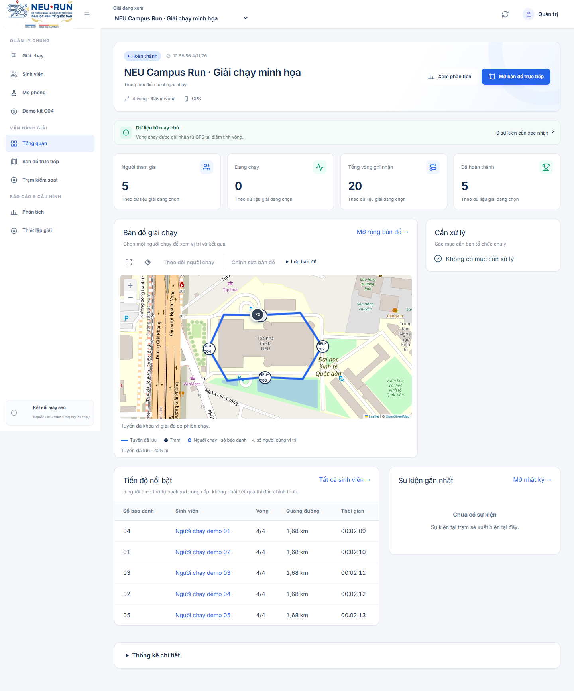

# NEU RUN — Web quản trị

Web quản trị hỗ trợ ban tổ chức cấu hình giải chạy, quản lý người tham gia và theo dõi kết quả trên một giao diện thống nhất.

## Giao diện

Trang Tổng quan tập hợp các chỉ số giải chạy, bản đồ tuyến, tiến độ người tham gia và sự kiện gần nhất. Thông tin trong ảnh là dữ liệu minh họa đã ẩn danh.

## Chức năng

- Quản lý giải chạy, danh sách sinh viên và đăng ký tham gia.
- Thiết lập tuyến chạy và trạm kiểm soát.
- Theo dõi người chạy trên bản đồ và xem tiến độ theo phiên.
- Tra cứu quãng đường, thời gian, bước chân và số vòng hợp lệ.
- Xem nhật ký trạm kiểm soát và xử lý sự kiện cần xác nhận.
- Xem thống kê và phân tích kết quả.
- Điều khiển mô phỏng giải chạy và demo bộ kit C04.

## Demo bộ kit C04

Màn hình demo kit cho phép lựa chọn cổng Serial, nhập thông tin người tham gia và theo dõi phiên chạy hai vòng.

Lượt qua đầu mở phiên; hai lượt hợp lệ tiếp theo xác nhận vòng thứ nhất và vòng thứ hai. Mỗi vòng yêu cầu tối thiểu 60 giây. Số vòng, thời gian và trạng thái hoàn tất được lấy từ backend.

Cảm biến xác nhận lượt qua thực tế; GPS và bước chân là dữ liệu mô phỏng. Màn hình kit sử dụng luồng điều khiển riêng với demo mô phỏng giải chạy.

## Công nghệ

React, TypeScript, Vite, React Router và Leaflet. Dữ liệu nghiệp vụ được trao đổi qua REST API và WebSocket.

## Cấu hình và vận hành

Giao diện hỗ trợ chế độ kết nối API và chế độ dữ liệu mẫu. Chế độ API cần backend tương thích và thông tin xác thực do người vận hành cung cấp.

Cấu hình kết nối được quản lý bằng biến môi trường. Khóa quản trị được nhập khi sử dụng và không được đưa vào cấu hình công khai của bản dựng.

## Kiểm tra chất lượng

Các bước kiểm tra gồm kiểm tra kiểu dữ liệu, quy tắc mã nguồn, kiểm thử tự động và tạo bản dựng. Kiểm thử giao diện bao gồm các kịch bản với phản hồi API giả lập.

Kết quả thử nghiệm bằng dữ liệu giả lập không thay thế việc kiểm thử tích hợp với backend và phần cứng thật.

## Nguyên tắc hiển thị

- Hiển thị đúng trạng thái do backend xác nhận.
- Phân biệt dữ liệu mô phỏng với dữ liệu thiết bị.
- Thông báo rõ khi mất kết nối hoặc chưa tải được dữ liệu.
- Sử dụng dữ liệu đã ẩn danh trong nội dung công khai.
