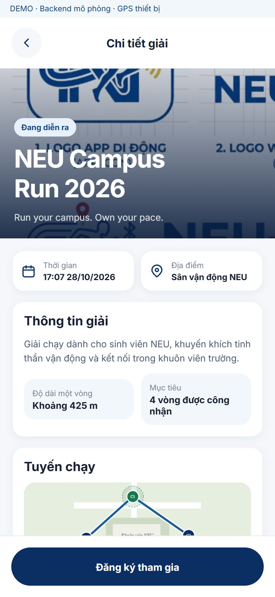

# NEU RUN — Ứng dụng sinh viên

Ứng dụng sinh viên hỗ trợ khám phá giải chạy, đăng ký tham gia, ghi nhận hoạt động và theo dõi kết quả cá nhân trên nền tảng NEU RUN.

## Giao diện

<table>
  <tr>
    <td align="center" width="50%"></td>
    <td align="center" width="50%"></td>
  </tr>
  <tr>
    <td align="center">Đăng nhập</td>
    <td align="center">Chi tiết giải chạy</td>
  </tr>
</table>

Ảnh minh họa từ bản xem trước trên web, không đại diện cho kiểm thử GPS trên thiết bị thật.

## Chức năng

- Đăng nhập và quản lý phiên xác thực.
- Khám phá giải chạy và xem thông tin tham gia.
- Đăng ký, nhận số báo danh và điểm danh.
- Bắt đầu, tạm dừng, tiếp tục và kết thúc phiên chạy.
- Thu thập GPS, gửi dữ liệu hoạt động và theo dõi tiến độ.
- Xem kết quả, lịch sử và thống kê cá nhân.
- Tham gia các hoạt động tích lũy quãng đường.

## Chế độ dữ liệu

| Chế độ | Mục đích |
| --- | --- |
| Dữ liệu mẫu | Xem trước giao diện và thử các luồng tương tác |
| Kết nối API | Trao đổi dữ liệu với backend tương thích |
| GPS mô phỏng | Minh họa chuyển động trong môi trường demo |
| GPS thiết bị | Thu thập vị trí từ thiết bị sau khi được cấp quyền |

Dữ liệu mẫu được quản lý độc lập với dữ liệu backend. Chế độ API không tự chuyển sang dữ liệu mẫu khi kết nối gặp lỗi.

## Vị trí và lưu trữ

Ứng dụng có cơ chế lưu trữ cục bộ và hàng đợi gửi dữ liệu. Thông tin xác thực trên thiết bị được quản lý bằng SecureStore.

Khả năng ghi GPS nền phụ thuộc nền tảng, cấu hình bản dựng, quyền truy cập và chính sách của hệ điều hành. Cần kiểm thử trên thiết bị thật để đánh giá hoạt động khi mất mạng hoặc khi ứng dụng chạy nền.

## Công nghệ

React Native, Expo và TypeScript; sử dụng Expo Location, Task Manager, SQLite và SecureStore. Trải nghiệm bản đồ phụ thuộc nền tảng và cấu hình dịch vụ bản đồ.

## Thiết lập và kiểm thử

Chuẩn bị môi trường di động phù hợp, cài đặt các phụ thuộc và cấu hình chế độ dữ liệu trước khi chạy. Chế độ API cần backend tương thích và tài khoản được cấp hợp lệ.

Quy trình kiểm tra gồm kiểm tra kiểu dữ liệu, quy tắc mã nguồn, kiểm thử tự động và xuất bản dựng ứng dụng. Bản xem trước trên trình duyệt phục vụ kiểm tra giao diện; các tính năng GPS và chạy nền cần được xác minh riêng trên thiết bị.

## Quyền riêng tư

Chỉ thu thập vị trí khi có sự cho phép phù hợp. Không đưa tài khoản, thông tin cá nhân hoặc lịch sử vị trí vào nội dung minh họa công khai. Không đóng gói khóa quản trị hoặc khóa thiết bị dùng chung trong ứng dụng.
