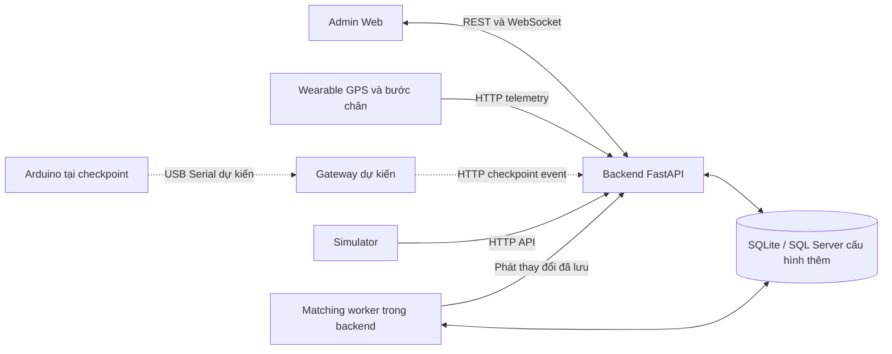

# MÔ TẢ BACKEND VÀ CHỨC NĂNG HỆ THỐNG NEU SMART RUNNING

Ngày đối chiếu mã nguồn: 12/10/2026.

Tài liệu mô tả phần đã triển khai trong checkout hiện tại, lấy `services/backend/app/main.py` và `services/backend/app/simulator.py` làm căn cứ chính. Đây là kết quả đọc mã nguồn, không phải biên bản kiểm thử thực địa hoặc xác nhận hệ thống đang vận hành. Một số README trong dự án chứa thông tin của phiên bản cũ.

## 1. Giới thiệu hệ thống

NEU Smart Running là hệ thống quản lý giải chạy và theo dõi hoạt động chạy của sinh viên thông qua dữ liệu GPS, số bước chân và các trạm checkpoint. Hệ thống hỗ trợ ban tổ chức thiết lập giải chạy, đăng ký người tham gia, liên kết thiết bị đeo, theo dõi tiến độ, ghi nhận vòng chạy và tra cứu kết quả.

Backend là thành phần xử lý trung tâm, tiếp nhận dữ liệu từ thiết bị hoặc trình mô phỏng, kiểm tra tính hợp lệ, thực hiện quy tắc nghiệp vụ và lưu kết quả vào cơ sở dữ liệu. Admin Web sử dụng REST API để quản trị, tra cứu dữ liệu và sử dụng WebSocket để nhận thay đổi trong quá trình chạy.

Hệ thống có hai chế độ ghi nhận checkpoint:

- `GPS_ONLY`: nhận biết người chạy đi vào vùng checkpoint dựa trên các mẫu GPS liên tiếp; có thể ghi vòng tại checkpoint loại `LAP`.
- `GPS_AND_ARDUINO`: GPS tạo bằng chứng đi qua checkpoint; backend đối chiếu bằng chứng này với sự kiện từ Arduino/Gateway trước khi xem xét ghi vòng.

Phiên bản hiện tại là MVP phục vụ phát triển, tích hợp và trình diễn. Phần backend đã có giao diện tiếp nhận dữ liệu phần cứng, nhưng thư mục Arduino và Gateway trong checkout chỉ chứa `.gitkeep`, chưa có chương trình điều khiển hoặc cầu nối Serial hoàn chỉnh.

## 2. Kiến trúc tổng thể

### 2.1. Các thành phần

| Thành phần | Vai trò |
|---|---|
| Admin Web | Giao diện quản lý giải chạy, sinh viên, checkpoint, bản đồ và nhật ký sự kiện |
| Backend FastAPI | Xác thực yêu cầu, xử lý nghiệp vụ, cung cấp REST API và WebSocket |
| Cơ sở dữ liệu | Lưu cấu hình giải, hồ sơ sinh viên, phiên chạy, GPS, vòng chạy và kết quả ghép sự kiện |
| Wearable | Nguồn dự kiến cung cấp GPS và tổng số bước chân của một người chạy |
| Arduino/Gateway | Nguồn dự kiến cung cấp sự kiện phát hiện người đi qua checkpoint; backend đã có API tiếp nhận |
| Simulator | Tạo người chạy và dữ liệu di chuyển giả lập để trình diễn qua API thật |
| Matching worker | Tác vụ nền trong backend, xử lý sự kiện Arduino đã đến hạn đối chiếu GPS |

Đường nét đứt biểu diễn luồng phần cứng dự kiến, chưa có mã triển khai đầy đủ trong checkout. Các thành phần được phân chia theo trách nhiệm; backend hiện là một ứng dụng đơn khối, phần lớn mã nằm trong `app/main.py`, chưa tách thành các dịch vụ độc lập.

### 2.2. Công nghệ sử dụng

| Công nghệ | Mục đích |
|---|---|
| Python | Ngôn ngữ lập trình backend và simulator |
| FastAPI | Khai báo endpoint, dependency xác thực và WebSocket |
| Uvicorn | Chạy ứng dụng ASGI |
| Pydantic | Khai báo cấu trúc và kiểm tra dữ liệu đầu vào |
| Pydantic Settings, dotenv | Đọc cấu hình từ biến môi trường và `.env` |
| SQLAlchemy | Ánh xạ đối tượng với bảng dữ liệu, truy vấn và giao dịch |
| SQLite | Cơ sở dữ liệu mặc định cho demo, lưu bền trên tệp |
| pyodbc | Thư viện hỗ trợ kết nối SQL Server khi cấu hình tương ứng |
| asyncio | Vận hành tác vụ ghép sự kiện nền và giao tiếp bất đồng bộ |
| React, TypeScript, Vite, Leaflet | Giao diện quản trị và hiển thị bản đồ |

SQLite được cấu hình bật khóa ngoại và chế độ WAL. Backend tạo bảng bằng `Base.metadata.create_all()` và có hàm bổ sung schema phục vụ database demo cũ. SQL Server là lựa chọn cấu hình, chưa được xác minh vận hành trong lần đọc mã này.

## 3. Tổ chức backend

Tệp `services/backend/app/main.py` gồm các nhóm trách nhiệm chính:

1. Đọc cấu hình, khởi tạo kết nối database và session.
2. Khai báo các bảng bằng SQLAlchemy ORM.
3. Khai báo hợp đồng dữ liệu đầu vào bằng Pydantic.
4. Kiểm tra API key theo vai trò.
5. Xử lý tuyến chạy, GPS, geofence, vòng chạy và ghép sự kiện.
6. Cung cấp API ghi dữ liệu và API tra cứu cho Admin Web.
7. Quản lý kết nối WebSocket theo từng giải.
8. Khởi động, dừng matching worker và tiến trình simulator.

Tệp `services/backend/app/simulator.py` là chương trình mô phỏng độc lập. Simulator sử dụng HTTP API để tạo dữ liệu và gửi telemetry, qua đó đi qua các bước kiểm tra nghiệp vụ của backend.

## 4. Thiết kế cơ sở dữ liệu

Backend hiện khai báo 15 bảng:

| Bảng | Nội dung chính |
|---|---|
| `races` | Tên, thời gian, trạng thái giải, số vòng mục tiêu, profile tuyến, cấu hình geofence/matching và phiên bản cấu hình |
| `students` | Mã sinh viên duy nhất, họ tên, khoa và trạng thái hồ sơ |
| `race_participants` | Liên kết sinh viên với giải, số báo danh và trạng thái đăng ký |
| `checkpoints` | Mã, tên, thứ tự, loại, tọa độ và bán kính checkpoint |
| `race_route_points` | Danh sách điểm GPS theo thứ tự tạo thành tuyến; một số điểm gắn checkpoint |
| `run_sessions` | Phiên chạy: sinh viên, giải, wearable, thời gian, trạng thái, tổng cự ly, số vòng, bước chân và GPS cuối |
| `gps_points` | Các mẫu GPS đã nhận, thời gian đo/nhận, số bước, nguồn và khóa chống lặp |
| `gps_passages` | Bằng chứng GPS đi vào checkpoint, người chạy liên quan và trạng thái đã dùng để ghép |
| `geofence_states` | Trạng thái vùng GPS theo từng cặp phiên chạy–checkpoint |
| `lap_events` | Vòng hợp lệ, số thứ tự vòng, thời điểm, thời lượng và sự kiện nguồn |
| `devices` | Thiết bị checkpoint, ánh xạ checkpoint, trạng thái và lần nhận dữ liệu gần nhất |
| `runner_wearables` | Thiết bị GPS/bước chân và sinh viên được gán |
| `device_events` | Sự kiện Gateway, trạng thái ghép, ứng viên, kết quả vòng và phiên bản xử lý |
| `match_audits` | Lịch sử xác nhận/loại bỏ sự kiện mơ hồ, lý do và khóa chống lặp thao tác |
| `idempotency_records` | Khóa chống tạo trùng phiên chạy, tài nguyên đã tạo và hash yêu cầu |

Một giải có nhiều người đăng ký, checkpoint, điểm tuyến và phiên chạy. Một sinh viên có thể đăng ký nhiều giải; bảng `race_participants` biểu diễn quan hệ này. Mỗi phiên chạy gắn một sinh viên, một giải và một wearable, đồng thời có nhiều mẫu GPS, passage và vòng chạy.

Cần phân biệt ba loại dữ liệu: `GpsPoint` là một mẫu tọa độ; `GPSPassage` là bằng chứng đi từ ngoài vào vùng checkpoint; `LapEvent` là một vòng đã được chấp nhận. Có mẫu GPS hoặc passage chưa đồng nghĩa với có thêm vòng.

UUID được dùng cho phần lớn khóa định danh nghiệp vụ. Mã thiết bị do bên đăng ký cung cấp. Số báo danh như `01`, `02` là thông tin hiển thị trong từng giải, không thay thế `student_id`.

## 5. Các chức năng nghiệp vụ

### 5.1. Quản lý giải chạy

Quản trị viên có thể tạo, liệt kê và xóa giải chạy. Khi tạo giải, backend lưu tên, thời gian dự kiến, trạng thái, số vòng mục tiêu, thời gian tối thiểu một vòng và chế độ checkpoint.

Hai profile tuyến được hỗ trợ là `CUSTOM` và `NEU_DEMO`. `NEU_DEMO` mặc định đặt cận chiều dài 400–450 m; `CUSTOM` chỉ áp dụng cận chiều dài khi được khai báo. Số vòng mục tiêu mặc định là 4 và thời gian tối thiểu một vòng mặc định là 30 giây, có thể cấu hình khi tạo giải.

Khi xóa giải, backend dừng simulator liên quan do chính backend quản lý, chốt các phiên đang hoạt động rồi xóa dữ liệu thuộc giải trong database. Hồ sơ sinh viên và wearable được giữ lại. Thiết bị hoặc simulator chạy ngoài sự quản lý của backend cần được dừng riêng.

### 5.2. Quản lý sinh viên và đăng ký tham gia

Hệ thống hỗ trợ tạo hồ sơ sinh viên, tìm kiếm hồ sơ và đăng ký sinh viên vào giải. Backend ngăn đăng ký lặp cùng sinh viên trong cùng giải và kiểm tra số báo danh đã được sử dụng. Nếu không cung cấp số báo danh, backend cấp số tiếp theo dựa trên các số hiện có.

Danh sách người tham gia chứa thông tin hồ sơ, số báo danh và trạng thái đăng ký. Hồ sơ sinh viên là dữ liệu dùng chung giữa các giải, còn kết quả chạy được lưu theo từng phiên.

### 5.3. Quản lý wearable và thiết bị checkpoint

Wearable gửi GPS và tổng bước chân trong cùng một request. Quản trị viên đăng ký mã wearable và gán thiết bị cho sinh viên. Khi tạo phiên hoặc tiếp nhận GPS, backend đối chiếu thiết bị, sinh viên và phiên chạy để tránh gán dữ liệu sai người.

Thiết bị checkpoint được đăng ký riêng và ánh xạ đến một checkpoint cụ thể. Gateway không được tự cung cấp danh tính người chạy: trường `student_id` phải là `null`. Backend xác định ứng viên bằng dữ liệu GPS đã liên kết với phiên chạy.

Hai nhóm thiết bị có trách nhiệm khác nhau: wearable cung cấp thông tin của người đã được gán thiết bị; cảm biến checkpoint chỉ cung cấp sự kiện có đối tượng đi qua.

### 5.4. Quản lý tuyến và checkpoint

Backend hỗ trợ tạo checkpoint, sửa thông tin checkpoint, đọc tuyến và thay toàn bộ tuyến GPS. Tuyến được lưu bằng danh sách điểm theo thứ tự, giúp bản đồ và simulator sử dụng cùng dữ liệu hình học.

Khi lưu tuyến, hệ thống kiểm tra:

- Số điểm trong khoảng 5–500.
- Điểm đầu và cuối cách nhau không quá 2 m.
- Mỗi checkpoint của giải có đúng một điểm neo trong tuyến.
- Không sử dụng checkpoint của giải khác.
- Thứ tự điểm neo tuân theo `sequence_no` quanh vòng, cho phép đổi điểm bắt đầu.
- Chiều dài đáp ứng các cận đã cấu hình.

Tọa độ checkpoint được đồng bộ với điểm neo khi thay tuyến. Sau khi đã tạo ít nhất một phiên chạy, backend khóa việc thêm/sửa checkpoint, thay tuyến và sửa cấu hình matching để duy trì điều kiện xử lý nhất quán.

Việc kiểm tra thứ tự checkpoint ở đây là kiểm tra cấu hình tuyến; chưa phải kiểm tra người chạy thực sự đã đi qua đủ checkpoint theo thứ tự.

### 5.5. Quản lý phiên chạy

Admin hoặc simulator có thể tạo phiên cho sinh viên đã đăng ký và có wearable phù hợp. Backend không cho cùng sinh viên có hai phiên `ACTIVE` trong cùng giải và không mở phiên mới trong giải đã `COMPLETED`.

Phiên chạy lưu thời điểm bắt đầu, thời điểm kết thúc, tổng thời gian, số vòng, cự ly, bước chân và vị trí cuối. Simulator được phép chỉ định thời điểm xuất phát trong 60 giây tới để đồng bộ hoặc giãn thời điểm xuất phát giữa các runner.

Khi số vòng đạt mục tiêu, phiên tự chuyển thành `COMPLETED` và chốt thời gian. Giải được đánh dấu hoàn thành khi phiên mới nhất của mọi người đã đăng ký đều hoàn thành. Khi dừng job mô phỏng, các phiên đang chạy liên quan được chuyển thành `CANCELLED`.

Admin còn có API kết thúc thủ công. API hiện đánh dấu `COMPLETED` kể cả khi chưa đủ số vòng. Vì vậy báo cáo kết quả cần phân biệt người có trạng thái hoàn thành với người thực sự đạt mục tiêu vòng; dashboard đã có chỉ số `runners_at_lap_target` riêng.

### 5.6. Tiếp nhận GPS và bước chân

Một gói telemetry gồm định danh giải, phiên, sinh viên, wearable, tọa độ, thời điểm ghi nhận, tổng bước chân và khóa chống gửi lặp. Độ chính xác GPS và tốc độ do thiết bị báo là trường tùy chọn.

Backend thực hiện các bước kiểm tra chính:

1. Xác thực nguồn simulator hoặc wearable.
2. Kiểm tra giải, sinh viên và thiết bị đúng với phiên `ACTIVE`.
3. Kiểm tra tọa độ trong miền hợp lệ.
4. Kiểm tra thời điểm không trước lúc bắt đầu phiên, không quá cũ hoặc quá xa trong tương lai.
5. Yêu cầu thời điểm mẫu GPS tăng nghiêm ngặt; tổng bước chân không giảm.
6. Tính tốc độ suy ra từ hai điểm GPS để loại bỏ bước nhảy vượt ngưỡng.
7. Lưu mẫu GPS, cập nhật tổng và xử lý checkpoint.
8. Commit dữ liệu rồi mới phát cập nhật WebSocket.

Các mặc định hiện tại là dữ liệu không cũ quá 10 giây, độ lệch tương lai không quá 2 giây; ngưỡng tốc độ 12 m/s cho wearable và 18 m/s cho simulator. Đây là tham số triển khai, không phải kết quả hiệu chuẩn phần cứng.

Cự ly tăng thêm được tính bằng Haversine giữa hai mẫu được chấp nhận liên tiếp:

`distance_total = distance_total trước đó + haversine(điểm trước, điểm mới)`.

Mẫu đầu tiên chưa có điểm trước để cộng cự ly. Backend nhận bước chân dưới dạng tổng tích lũy và thay snapshot bằng giá trị mới; không cộng lại toàn bộ số bước ở mỗi request. Backend cũng không tự suy ra bước chân thật từ GPS.

Nguồn telemetry được quyết định bởi khóa xác thực, sau đó lưu thành `SIMULATED_GPS` hoặc `WEARABLE_GPS`; trường `source` do client gửi không quyết định nguồn GPS được công nhận.

### 5.7. Ghi nhận trong chế độ GPS_ONLY

Backend so sánh khoảng cách của điểm GPS trước và điểm hiện tại đến từng checkpoint. Passage được tạo khi điểm trước nằm ngoài bán kính checkpoint và điểm mới đi vào trong hoặc trên biên bán kính.

Nếu checkpoint là `LAP`, backend xem xét ghi vòng theo quy tắc thời gian và trạng thái phiên. Checkpoint khác vẫn có thể ghi passage phục vụ theo dõi nhưng không tự tăng vòng trong luồng GPS này.

Sự kiện Arduino được gửi vào một giải `GPS_ONLY` vẫn được lưu, nhưng mang trạng thái `UNASSIGNED` với lý do `GPS_ONLY_MODE` và không được dùng để cộng vòng.

### 5.8. Ghi nhận trong chế độ GPS_AND_ARDUINO

Chế độ kết hợp dùng trạng thái geofence bền vững theo từng phiên–checkpoint:

| Trạng thái | Ý nghĩa |
|---|---|
| `UNKNOWN` | Chưa có đủ trạng thái trước để khẳng định một lượt đi vào |
| `OUTSIDE` | Đã có mẫu tại hoặc ngoài bán kính ngoài |
| `INSIDE` | Đã có mẫu tại hoặc trong bán kính trong |

Bán kính trong mặc định là 10 m và bán kính ngoài là 15 m. Vùng giữa hai bán kính giúp tránh tạo passage liên tục khi GPS dao động sát biên. Chỉ chuyển từ `OUTSIDE` sang `INSIDE` mới tạo passage. Nếu khoảng cách thời gian giữa các mẫu vượt 5 giây, trạng thái được khởi tạo lại thành `UNKNOWN`; mẫu đầu tiên ở trong vùng không tự chứng minh một lượt đi vào.

Khi nhận sự kiện Gateway hợp lệ, backend lưu trạng thái `PENDING_MATCH`. Cửa sổ ghép mặc định là ±3 giây quanh thời điểm sự kiện, cộng 2 giây chờ dữ liệu đến trễ. Matching worker quét database khoảng mỗi giây và xử lý khi cửa sổ đã đóng; nếu còn cửa sổ sự kiện chồng lấn, quyết định có thể được trì hoãn thêm.

Ứng viên phải thuộc cùng giải và checkpoint, có thời điểm phù hợp, được nhận trước hạn, đúng phiên bản cấu hình, đúng liên kết sinh viên–wearable và chưa dùng cho sự kiện khác.

| Kết quả đối chiếu | Xử lý |
|---|---|
| Một ứng viên duy nhất, không tranh chấp | Tự ghép thành `MATCHED` |
| Nhiều ứng viên hoặc nhiều sự kiện cạnh tranh cùng passage | Chuyển `AMBIGUOUS`, chờ Admin |
| Không có passage phù hợp | Chuyển `UNASSIGNED`, lưu mã lý do |
| Sự kiện quá cũ | Lưu `UNASSIGNED` với lý do `LATE_DEVICE_EVENT` |

Backend không tự chọn người gần checkpoint nhất trong trường hợp mơ hồ. Một passage đã sử dụng không được dùng để xác nhận sự kiện khác.

### 5.9. Xử lý thủ công sự kiện mơ hồ

Admin có thể xác nhận một `passage_id` trong danh sách ứng viên hoặc loại bỏ sự kiện `AMBIGUOUS`. Thao tác yêu cầu lý do, `expected_version` và `idempotency_key`.

Backend kiểm tra lại phiên bản sự kiện, danh sách ứng viên đã chốt và khả năng sử dụng passage. Nếu dữ liệu đã thay đổi hoặc passage đã được dùng, yêu cầu bị từ chối để tránh ghi nhận sai. Kết quả được lưu trong `match_audits`; loại bỏ sự kiện tạo trạng thái `REJECTED`.

Audit hiện ghi người thao tác dưới vai trò `ADMIN_KEY_DEMO`, chưa định danh từng tài khoản quản trị.

### 5.10. Quy tắc tính vòng

Hàm `record_lap()` là điểm dùng chung để cập nhật vòng. Hàm kiểm tra phiên còn `ACTIVE`, thời điểm vòng sau mốc trước, đủ thời gian tối thiểu và chưa đạt số vòng mục tiêu. Mốc tính thời lượng vòng đầu là lúc bắt đầu phiên; các vòng sau dùng thời điểm vòng trước.

Khi hợp lệ, backend tăng `lap_count`, lưu `LapEvent`, cập nhật thời lượng vòng gần nhất và xem xét tự hoàn thành phiên. Luồng GPS trực tiếp và luồng Arduino đã ghép chỉ gọi ghi vòng khi checkpoint có loại `LAP`.

Trạng thái ghép danh tính và trạng thái tính vòng được lưu riêng. `MATCHED` không đồng nghĩa `COUNTED`: một sự kiện có thể ghép được người nhưng không đủ thời gian tối thiểu, checkpoint không phải `LAP` hoặc phiên đã kết thúc.

API `/lap-events` là đường ghi vòng riêng dành cho simulator và bị chặn ở chế độ `GPS_AND_ARDUINO`. API này kiểm tra runner/checkpoint cùng phiên–giải và luật thời gian, nhưng hiện chưa kiểm tra `checkpoint.kind` như hai luồng tự động nêu trên.

### 5.11. Dashboard, bản đồ và lịch sử

Dashboard tổng hợp số người đăng ký, chưa bắt đầu, đang chạy, hoàn thành, đạt mục tiêu vòng; tổng số vòng, cự ly, bước chân; thời gian trung bình của người hoàn thành; số sự kiện theo trạng thái ghép; tiến độ passage tại checkpoint và các sự kiện gần nhất.

Danh sách runner hỗ trợ tìm theo mã hoặc tên, lọc trạng thái, sắp xếp và phân trang. API chi tiết phiên cung cấp thông số tổng hợp; API lịch sử trả các bản ghi GPS và LAP theo thời gian. Nhật ký checkpoint hỗ trợ lọc theo checkpoint, trạng thái, khoảng thời gian và phân trang bằng cursor.

API live trả vị trí cuối của phiên mới nhất của mỗi sinh viên cùng tuyến đã lưu. Vị trí của người đã hoàn thành là vị trí cuối phiên, không phải bằng chứng thiết bị vẫn đang gửi dữ liệu.

Danh sách `top_runners` hiện ưu tiên số vòng giảm dần, cự ly giảm dần, thời gian tăng dần rồi số báo danh. Đây là quy tắc hiển thị tiến độ của phiên bản hiện tại, chưa nên coi là bảng xếp hạng thi đấu đã chuẩn hóa.

### 5.12. Cập nhật thời gian thực

Admin Web đọc snapshot qua REST rồi mở WebSocket theo giải. Backend phát các loại sự kiện:

| Sự kiện | Mục đích |
|---|---|
| `runner.updated` | Cập nhật vị trí hoặc thông số runner |
| `runner.completed` | Thông báo kết thúc phiên ở các luồng tương ứng |
| `checkpoint.passed` | Thông báo passage GPS và kết quả xử lý tại checkpoint |
| `checkpoint.match.updated` | Cập nhật trạng thái ghép GPS/Arduino |

Kết nối được quản lý bằng `EventHub` trong bộ nhớ của một tiến trình. Dữ liệu nghiệp vụ được commit trước khi phát thông báo. WebSocket không phải kho lịch sử; sau khi mất kết nối, frontend cần đọc lại REST để đồng bộ.

### 5.13. Mô phỏng hệ thống

Admin có thể khởi động, theo dõi log/trạng thái và dừng job mô phỏng. API mô phỏng mặc định tạo 5 sinh viên, số báo danh `01`–`05`, wearable, checkpoint, tuyến và các phiên chạy. CLI cho phép tùy chỉnh số sinh viên và số vòng.

Tuyến mô phỏng khép kín đi qua bốn checkpoint quanh tòa Thế Kỷ, có chiều dài khoảng 425 m. C01 là checkpoint tính vòng; các điểm bẻ bổ sung phục vụ mô phỏng hình học, chưa được xác minh là tuyến chạy thực địa.

Simulator nội suy vị trí theo khoảng cách đã di chuyển, tạo tổng bước chân dựa trên sải bước giả lập và gửi dữ liệu qua API. Chu kỳ mặc định là 0,5 giây. Ở `GPS_ONLY`, các runner xuất phát đồng thời; ở `GPS_AND_ARDUINO`, mặc định cách nhau 8 giây để giảm chồng lấn sự kiện. Có thể đặt khoảng cách bằng 0 để thử tình huống mơ hồ.

Dữ liệu giải, GPS và vòng được lưu trong database. Danh sách job và tiến trình mô phỏng được quản lý trong bộ nhớ; sau khi backend khởi động lại, thông tin job cũ có thể không còn dù dữ liệu giải vẫn tồn tại.

## 6. Danh mục API

Các đường dẫn trong bảng có tiền tố `/api/v1`, trừ những đường dẫn được ghi riêng.

| Nhóm | Phương thức và đường dẫn | Chức năng |
|---|---|---|
| Xác thực | `POST /auth/admin-key` | Kiểm tra Admin key |
| Giải chạy | `POST /races`; `GET /races` | Tạo và liệt kê giải |
| Giải chạy | `DELETE /races/{race_id}` | Xóa giải và dữ liệu thuộc giải |
| Sinh viên | `POST /students`; `GET /students` | Tạo và tìm hồ sơ |
| Đăng ký | `POST`, `GET /races/{race_id}/participants` | Đăng ký và đọc danh sách tham gia |
| Wearable | `POST /runner-devices` | Đăng ký thiết bị đeo cho sinh viên |
| Checkpoint | `POST /races/{race_id}/checkpoints` | Tạo checkpoint |
| Checkpoint | `PATCH /checkpoints/{checkpoint_id}` | Sửa checkpoint |
| Thiết bị trạm | `POST /checkpoints/{checkpoint_id}/devices` | Gán Gateway vào checkpoint |
| Tuyến | `GET`, `PUT /races/{race_id}/route` | Đọc hoặc thay tuyến |
| Matching | `GET`, `PATCH /races/{race_id}/checkpoint-matching` | Đọc hoặc sửa cấu hình ghép |
| Phiên | `POST /runs` | Tạo phiên chạy |
| Phiên | `POST /runs/{run_id}/finish` | Kết thúc thủ công |
| Telemetry | `POST /telemetry/gps` | Nhận GPS và tổng bước chân |
| Gateway | `POST /checkpoint-events` | Nhận sự kiện checkpoint |
| Sự kiện | `GET /checkpoint-events/{event_id}` | Đọc chi tiết và ứng viên |
| Gateway | `GET /gateway/checkpoint-events/{event_id}` | Đọc trạng thái rút gọn bằng Gateway key |
| Nhật ký | `GET /races/{race_id}/checkpoint-events` | Lọc và phân trang nhật ký ghép |
| Xử lý | `POST /checkpoint-events/{event_id}/resolve` | Xác nhận hoặc loại bỏ sự kiện mơ hồ |
| Vòng mô phỏng | `POST /lap-events` | Nhận vòng trực tiếp từ simulator |
| Tổng quan | `GET /races/{race_id}/overview` | Thống kê tổng quan |
| Dashboard | `GET /races/{race_id}/dashboard` | Snapshot quản trị tổng hợp |
| Runner | `GET /races/{race_id}/runners` | Danh sách và bộ lọc runner |
| Bản đồ | `GET /races/{race_id}/live` | Snapshot tuyến và vị trí |
| Chi tiết | `GET /runners/{student_id}/runs/{run_id}` | Chi tiết phiên |
| Lịch sử | `GET /runners/{student_id}/runs/{run_id}/events` | Lịch sử GPS/LAP |
| Nhật ký thiết bị | `GET /races/{race_id}/device-events` | Danh sách sự kiện thiết bị rút gọn |
| Mô phỏng | `POST /simulations` | Khởi động job |
| Mô phỏng | `GET /simulations/{simulation_id}` | Đọc trạng thái/log |
| Mô phỏng | `POST /simulations/{simulation_id}/stop` | Dừng job |

Ngoài ra có `GET /health` để đọc phản hồi trạng thái cơ bản, `/docs` để xem tài liệu API do FastAPI cung cấp, `/` chuyển đến tài liệu và WebSocket `/ws/v1/races/{race_id}/live`.

## 7. Xác thực và tính toàn vẹn dữ liệu

Backend dùng bốn nhóm API key:

| Header | Vai trò |
|---|---|
| `X-Admin-Key` | Quản trị, tra cứu và xử lý nghiệp vụ |
| `X-Simulator-Key` | Gửi dữ liệu mô phỏng và tạo phiên theo quyền cho phép |
| `X-Wearable-Key` | Gửi telemetry từ wearable |
| `X-Gateway-Key` | Gửi sự kiện checkpoint và đọc kết quả rút gọn |

Khóa và chuỗi kết nối được cấu hình qua môi trường hoặc `.env`. Mã có giá trị mặc định phục vụ phát triển. WebSocket nhận Admin key qua query `key`. CORS được cấu hình theo origin của giao diện.

Cơ chế idempotency giúp gửi lại một yêu cầu mà không cộng trùng dữ liệu. Tạo phiên, nhận GPS và xử lý Admin sử dụng khóa chống lặp; sự kiện thiết bị dùng định danh sự kiện nguồn. Với các luồng có hash payload, cùng khóa nhưng nội dung khác sẽ bị báo xung đột. API vòng trực tiếp có kiểm tra lặp bằng `source_event_id` nhưng chưa so sánh đầy đủ payload như luồng GPS.

Các ràng buộc dữ liệu, kiểm tra liên kết nghiệp vụ, phiên bản sự kiện và giao dịch database hỗ trợ duy trì tính nhất quán. Mã lỗi nghiệp vụ thường gồm `code`, `message`, `details`, `trace_id`; lỗi validation tự động của FastAPI có cấu trúc riêng.

## 8. Quy trình sử dụng điển hình

1. Admin xác thực và tạo giải, chọn số vòng mục tiêu cùng chế độ checkpoint.
2. Tạo các checkpoint, lưu tuyến khép kín và cấu hình matching.
3. Tạo/chọn hồ sơ sinh viên, đăng ký tham gia và gán wearable; đăng ký thiết bị checkpoint nếu dùng chế độ kết hợp.
4. Tạo phiên chạy. Cấu hình tuyến và matching được khóa.
5. Wearable hoặc simulator gửi GPS và tổng bước chân.
6. Backend kiểm tra, lưu dữ liệu, tính cự ly và phát hiện passage.
7. Ở `GPS_ONLY`, passage tại checkpoint `LAP` được xét tính vòng trực tiếp. Ở `GPS_AND_ARDUINO`, passage chờ ghép với sự kiện Gateway.
8. Admin theo dõi dashboard/bản đồ và xử lý sự kiện mơ hồ khi cần.
9. Khi runner đủ vòng, backend chốt phiên; khi mọi người đăng ký đều có phiên mới nhất hoàn thành, backend hoàn thành giải.
10. Admin tra cứu thông số và lịch sử GPS/LAP phục vụ tổng hợp báo cáo.

## 9. Phạm vi đã có và giới hạn cần nêu

| Nội dung | Đánh giá theo mã nguồn |
|---|---|
| REST, WebSocket, database và simulator | Đã có mã triển khai |
| Quản lý giải, đăng ký sinh viên, tuyến/checkpoint | Đã có API và các màn hình quản trị tương ứng trong frontend |
| Đăng ký wearable, tạo/kết thúc phiên thủ công | Đã có API; không mặc định coi mọi API đều có màn hình thao tác tương ứng |
| GPS geofence và ghép sự kiện Arduino | Đã có logic backend; không thay thế việc kiểm thử với phần cứng thực |
| Firmware Arduino và chương trình Gateway | Thư mục mới có tệp giữ chỗ trong checkout |
| Kiểm tra runner đi đủ checkpoint theo thứ tự | Chưa có quy tắc bắt buộc trong logic ghi vòng hiện tại |
| Kiểm tra bám đúng tuyến, chống cắt đường | Chưa có thuật toán đối chiếu toàn bộ đường chạy với polyline |
| Xác minh người thật trước cảm biến | Chưa có; matching là suy luận tương quan GPS–thời gian |
| Tài khoản cá nhân/JWT và phân quyền chi tiết | Chưa có; đang sử dụng khóa theo vai trò |
| Khóa mật mã riêng cho từng wearable | Chưa có; Wearable key dùng chung theo vai trò |
| Xuất báo cáo Excel/PDF, đồng bộ Google Sheets | Chưa có endpoint chuyên dụng trong backend hiện tại |
| Đa tiến trình/đa máy chủ | WebSocket và job simulator còn phụ thuộc bộ nhớ tiến trình; matching cần điều phối khi mở rộng |
| Migration production | Chưa có quy trình Alembic hoàn chỉnh |

Các hướng phát triển phù hợp gồm hoàn thiện firmware/Gateway, kiểm thử sai số GPS tại hiện trường, thêm luật đi qua checkpoint theo thứ tự, phân biệt hoàn thành đủ vòng với dừng thủ công, chuẩn hóa xếp hạng và xây dựng quản lý tài khoản. Khi tăng quy mô, cần tối ưu truy vấn tổng hợp/phân trang, bổ sung điều phối worker và kênh phát sự kiện dùng chung.

## 10. Đoạn thuyết minh có thể đưa vào báo cáo

Backend của hệ thống NEU Smart Running được xây dựng bằng Python và FastAPI, sử dụng SQLAlchemy để quản lý dữ liệu và SQLite làm cơ sở dữ liệu mặc định cho phiên bản thử nghiệm. Backend cung cấp REST API cho các chức năng quản lý giải chạy, sinh viên, đăng ký tham gia, thiết bị, checkpoint và phiên chạy; đồng thời cung cấp WebSocket để truyền cập nhật đến giao diện quản trị. Dữ liệu GPS và tổng bước chân được tiếp nhận từ wearable hoặc trình mô phỏng, kiểm tra tính hợp lệ rồi lưu trữ để tính cự ly, theo dõi vị trí và ghi nhận tiến độ.

Hệ thống hỗ trợ chế độ ghi nhận checkpoint bằng GPS và chế độ kết hợp GPS với sự kiện Arduino. Trong chế độ kết hợp, backend tạo bằng chứng đi qua checkpoint từ sự chuyển trạng thái geofence, sau đó đối chiếu bằng chứng với sự kiện thiết bị trong một cửa sổ thời gian cấu hình. Trường hợp có một ứng viên duy nhất được tự động ghép; trường hợp mơ hồ cần quản trị viên xác nhận. Quy trình tách riêng kết quả ghép danh tính và kết quả tính vòng nhằm hạn chế cộng vòng khi bằng chứng hoặc điều kiện nghiệp vụ chưa đáp ứng.

Các kết quả về số vòng, cự ly, bước chân, thời gian và trạng thái phiên được tổng hợp trên dashboard và lưu lịch sử phục vụ tra cứu. Phiên bản hiện tại hoàn thiện nền tảng backend và mô phỏng cho việc tích hợp, đồng thời còn cần bổ sung phần mềm phần cứng thực tế, kiểm tra tuân thủ toàn bộ tuyến, xác thực tài khoản cá nhân và cơ chế triển khai ở quy mô lớn.

## 11. Nguồn đối chiếu trong dự án

- `services/backend/app/main.py`: model dữ liệu, API, quy tắc GPS/vòng, matching worker và WebSocket.
- `services/backend/app/simulator.py`: tuyến demo, tạo runner và phát telemetry mô phỏng.
- `services/backend/requirements.txt`: thư viện backend.
- `services/backend/README.md`: hướng dẫn vận hành và tích hợp, được kiểm tra lại với mã nguồn.
- `apps/admin-web/src/app/main.tsx`: các trang chính của giao diện quản trị.
- `apps/admin-web/src/features/`: các màn hình giải chạy, sinh viên, checkpoint, dashboard và bản đồ.
- `arduino/checkpoint/`, `services/arduino-gateway/`: đối chiếu phạm vi mã phần cứng hiện có.
